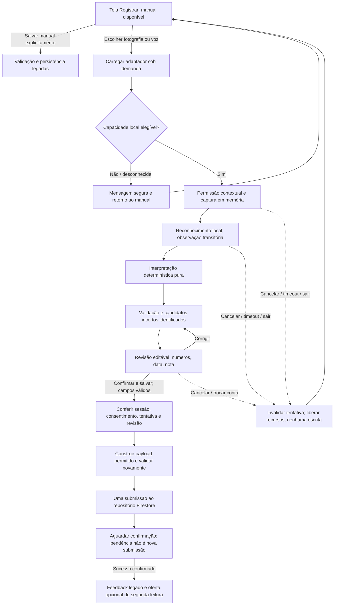

# Arquitetura de entrada assistida — TASK-03

**Data:** 26/10/2026. **Base de código:** `7d72cb3347dca04bde9b8a706f523a6da245dea2`, com os documentos locais das TASK-01/02. **Natureza da entrega:** desenho técnico; os nomes de arquivos, interfaces e comportamentos futuros abaixo não são módulos implementados ou compatibilidade já comprovada.

Fontes normativas: [constituição §§2–4](../constitution.md), [fotografia §§3–6](../specs/spec-fotografia.md), [voz §§3–7](../specs/spec-voz.md) e [PDF §4/§7.4](../specs/spec-relatorio-pdf.md). A [baseline](./baseline-legado.md) contém a evidência anterior do legado; a [revisão das specs](./revisao-specs.md) distingue decisões fechadas, fontes técnicas e pendências. Não foram realizadas novas consultas de documentação externa, instalações, builds ou PoCs nesta tarefa.

## 1. Decisões preservadas e limites

| Plataforma/modalidade | Decisão definitiva a concretizar | Condição de habilitação |
|---|---|---|
| Android/fotografia | ML Kit Text Recognition v2, modelo latino **embarcado**; quadro de câmera em memória | Bridge/câmera compatível com Expo Dev Client, sem arquivo intermediário, aprovada pela TASK-04 |
| Web/fotografia | Tesseract.js/LSTM em Web Worker; `getUserMedia` e canvas/bitmap/buffer em memória | Empacotamento do worker/modelo, captura e descarte comprovados na TASK-04 |
| Android/voz | `SpeechRecognizer.createOnDeviceSpeechRecognizer`, com serviço e pt-BR locais | API 31+ para essa modalidade, disponibilidade real e privacidade comprovadas na TASK-05. Isso não altera o minSdk do app inteiro |
| Web/voz | Web Speech com `processLocally = true` **somente onde comprovado**, pt-BR local | Suporte real, idioma/modelo e ausência de envio/retenção comprovados na TASK-05; desconhecido significa indisponível |

Não há adaptador remoto, endpoint de reconhecimento, fallback em nuvem, serviço novo de backend, OpenCV operacional ou Whisper no fluxo do produto. Whisper.cpp continua apenas como comparador acadêmico da TASK-21. A ausência de uma capacidade oferece retorno ao manual; não troca de motor automaticamente.

Bindings, versões exatas dos motores/modelos, navegadores/aparelhos suportados e limites quantitativos ainda serão registrados nas PoCs e consolidados na TASK-06. As versões observadas em documentação pela TASK-02 não são versões já adotadas. O app atual usa Expo 57.0.8, RN 0.86.0 e SDK JS Firebase para o CRUD; não existe integração de captura/reconhecimento nesta base.

O TAP original continua inacessível e a semântica de origem após edição/sessão, [P01](./revisao-specs.md#p01-origem), continua proposta, sem aprovação. O pedido atual autoriza este desenho e o planejamento das PoCs apesar dessas dependências ainda abertas. Não se trata de autorização para resolver P01 silenciosamente ou aceitar as novas funcionalidades. As PoCs abaixo não persistem medições e não dependem dessa escolha de origem.

## 2. Organização proposta e fronteiras

Os caminhos abaixo são **destinos futuros sugeridos**, alinhados às pastas e ao padrão `.native.ts`/`.web.ts` existentes. Nenhum desses novos arquivos foi criado nesta tarefa.

```text
app/(app)/index.tsx                         composição; preserva formulário manual
src/components/bp/AssistedReadingReview.tsx revisão; recebe estado e ações, sem Firebase
src/features/assisted-entry/
  useAssistedEntry.ts                       coordena tentativa, revisão e descarte
src/domain/
  assisted-entry.ts                         observações/candidatos; tipos sem SDK/I/O
  interpret-photo.ts                       SYS/DIA/PUL, rótulos/posição; função pura
  interpret-voice-pt-br.ts                  gramática da spec; função pura
src/services/recognition/
  recognition-ports.ts                     contratos de recursos e operações locais
  recognition-loader.native.ts / .web.ts   importação sob demanda, sem efeito no import
  photo-adapter.native.ts / .web.ts        captura e OCR locais, sem persistência
  voice-adapter.native.ts / .web.ts        sessão de reconhecimento local
src/features/readings/
  useConfirmAssistedReading.ts              porta de confirmação e criação clínica
  useAddReading.ts / useUpdateReading.ts    integração futura coordenada da origem
  reading.schema.ts / readings.repo.ts      validação e Firestore existentes, a adaptar
```

`app/ → features/ → services/` mantém a direção atual. Features e services podem consumir tipos/funções puras de `domain`; domínio não importa React, features, Firebase, arquivos, câmera ou reconhecedores. Componentes recebem candidatos e rascunhos, nunca frames ou clientes de banco. Não criar um barrel que reexporte os motores para a home e provoque carregamento antecipado.

**Os adaptadores não recebem UID, credencial, repositório, função de salvar nem cliente Firebase.** Eles só conhecem recursos locais, escopo cancelável e resultados temporários. A feature de leituras é a única fronteira com `readings.repo.ts`. Nunca ligar escrita a um efeito de “resultado disponível”, evento do motor ou validação bem-sucedida.

### Fluxo proposto



A captura, o reconhecimento, a interpretação, o preview e a validação **não autorizam escrita alguma, inclusive `addDoc`, `setDoc`, `updateDoc`, rascunho no Firestore ou fila offline**. Só a ação explícita de confirmação da revisão válida pode chegar a `W`. O botão Salvar do manual continua sendo sua confirmação explícita, sem dependência dos motores.

## 3. Adaptadores Android/Web

| Adaptador | Entrada e saída | Responsabilidade e proibições |
|---|---|---|
| Fotografia Android | Sessão de câmera → lease de frame nativo → tokens OCR com caixas normalizadas | Bridge deve entregar `media.Image`/buffer ou equivalente ao ML Kit, sem URI de fotografia. Uma integração de frames como `ImageAnalysis` é opção a investigar, não binding já adotado. Enquanto o motor lê, o frame permanece válido; fechamento ocorre após liberar o uso nativo |
| Fotografia Web | `MediaStream` → quadro de vídeo em canvas/`ImageBitmap`/buffer → tokens OCR | Uma captura e um reconhecimento por vez. Transferir buffer ao worker quando suportado, sem cópia clínica persistente. Auditar formato de entrada aceito na versão escolhida, outputs de posição e empacotamento pelo Metro; não presumir que `new Worker` sobre um arquivo TS funcione sem a PoC |
| Voz Android | Sessão do reconhecedor local em pt-BR → transcrição **final** em memória | O serviço nativo controla a captura; não exigir PCM acessível no JS, gravação paralela ou arquivo WAV. Consultar disponibilidade local e idioma antes de escutar; `EXTRA_PREFER_OFFLINE` não atende sozinho. `stop` finaliza fala, `cancel` abandona, `destroy` libera a instância |
| Voz Web | Sessão Web Speech local/pt-BR → transcrição **final** em memória | Verificar API/modo/idioma efetivos antes de iniciar. Atribuir uma propriedade desconhecida em JS não comprova suporte. Nunca chamar o reconhecedor remoto padrão se a verificação falhar; não acrescentar `MediaRecorder` ou captura de áudio paralela |

Os adaptadores apenas normalizam formatos e coordenadas de saída do SDK, sem decidir que um número é pressão, completar campos, classificar ou salvar. Conversão de orientação/recorte ocorre em memória. A feature usa resultados com o mesmo sistema de coordenadas descrito no contrato; não mistura caixas de frame original com caixas de imagem rotacionada.

Um probe não solicita permissão nem inicia câmera/microfone. O resultado “pronto” requer capacidade observada **e** integração elegível pela inspeção da PoC; uma flag de API não prova não retenção. O carregamento do modelo estático Web pode precisar de rede antes da captura; isso é distinto de enviar dados ao reconhecimento. Instalação de pacote de voz, quando cabível, é preparação explícita, sem capturar áudio enquanto o modelo falta.

## 4. Exemplos de contratos TypeScript

Estes blocos são declarações ilustrativas do desenho, não alterações ao `models.ts` atual. Os contratos de domínio, portas e escrita devem ficar em seus respectivos locais da seção 2. Os exemplos numéricos são sintéticos. Tipagem ajuda a evitar chamadas acidentais, mas não substitui validação em runtime, inspeção de dependências ou Security Rules.

### Observações e candidatos no domínio puro

```ts
export type EntryModality = 'photo' | 'voice';
export type ClinicalField = 'systolic' | 'diastolic' | 'pulse';

export interface NormalizedBox {
  readonly x: number;      // 0..1, origem no topo esquerdo
  readonly y: number;
  readonly width: number;
  readonly height: number;
}

export interface OcrObservation {
  readonly kind: 'ocr';
  readonly capturedAtMs: number; // relógio civil no instante da captura
  readonly coordinateSpace: 'upright-frame';
  readonly tokens: readonly {
    readonly text: string;       // sensível; somente memória
    readonly box: NormalizedBox;
    readonly confidence: number | null;
  }[];
}

export interface FinalTranscript {
  readonly kind: 'transcript';
  readonly locale: 'pt-BR';
  readonly final: true;
  readonly capturedAtMs: number; // início da captura, não chegada da resposta
  readonly text: string;        // sensível; somente memória
}

export type CandidateField =
  | { readonly status: 'candidate'; readonly value: number;
      readonly basis: 'label' | 'layout' | 'explicit-phrase' | 'colloquial-pair' }
  | { readonly status: 'missing' }
  | { readonly status: 'uncertain';
      readonly reason: 'ambiguous-label' | 'mixed-scale' | 'multiple-pairs'
        | 'unidentified-number' | 'unreadable' };

export interface CandidateSet {
  readonly modality: EntryModality;
  readonly capturedAtMs: number;
  readonly fields: Readonly<Record<ClinicalField, CandidateField>>;
}

export declare function interpretPhoto(value: OcrObservation): CandidateSet;
export declare function interpretVoice(value: FinalTranscript): CandidateSet;

// Exemplos de saídas esperadas, não resultados de um motor executado:
export const photoExample: CandidateSet = {
  modality: 'photo', capturedAtMs: 1793001600000,
  fields: {
    systolic: { status: 'candidate', value: 120, basis: 'label' },
    diastolic: { status: 'candidate', value: 80, basis: 'label' },
    pulse: { status: 'missing' },
  },
};

// "doze por oitenta": não decidir 120/80 por conveniência.
export const mixedScaleExample: CandidateSet = {
  modality: 'voice', capturedAtMs: 1793001600000,
  fields: {
    systolic: { status: 'uncertain', reason: 'mixed-scale' },
    diastolic: { status: 'uncertain', reason: 'mixed-scale' },
    pulse: { status: 'missing' },
  },
};
```

Observações recebidas do motor são `unknown` até checagem de forma/tamanho/números finitos pelo adaptador; não converter um JSON desconhecido em contrato por cast. A confiança pode orientar indicação de incerteza, nunca confirmar. Valores fora da faixa podem ser candidatos e receber erro de validação; não os corrigir, escalar ou trocar silenciosamente para passar no schema.

`missing` deixa o campo vazio. `uncertain` deixa o campo vazio **com motivo acessível**, mesmo que o motor tenha retornado números plausíveis. Pulso ausente vira vazio na revisão e `null` somente no payload validado. Campos obrigatórios incertos devem ser corrigidos antes de confirmar; o usuário pode preencher manualmente um campo incerto e ele passa a ser um valor revisado, sem ficar bloqueado para sempre pela classificação inicial.

O parser de voz só recebe resultado final. “Doze por oito” e “cento e vinte por oitenta” produzem 120/80; “treze vírgula cinco por oito vírgula cinco” produz 135/85, sem arredondamento; pulso exige rótulo inequívoco. Silêncio não cria candidato. Dois pares/autocorreção na mesma fala ficam ambíguos. Data, hora e observação não são inferidas da fala/display nem completadas pelo histórico.

Na fotografia, associar SYS/DIA/PUL pelos rótulos e proximidade/organização das caixas no frame normalizado. Um layout sem rótulo só pode usar regra explícita e avaliada daquele layout, não a ordem dos números nem a faixa válida como prova de identidade. Ignorar números acessórios de memória/data/hora; conflito de associação gera `uncertain`. Não aplicar a conversão coloquial da voz aos números do display. Regras e casos de interpretação completos pertencem à TASK-09; o adaptador não os incorpora como heurística oculta.

### Portas locais, disponibilidade e recursos

```ts
export type UnavailableReason =
  | 'unsupported-platform' | 'unsupported-api' | 'permission-denied'
  | 'device-unavailable' | 'local-service-unavailable' | 'language-unavailable'
  | 'model-missing' | 'privacy-unverified' | 'resource-limit';

export interface SafeIssue {
  readonly stage: 'load' | 'capture' | 'recognize' | 'interpret' | 'cleanup' | 'persist';
  readonly code: 'timeout' | 'capture-failed' | 'engine-failed'
    | 'interrupted' | 'malformed-output' | 'cleanup-failed' | 'write-rejected';
  readonly retry: 'new-attempt' | 'after-environment-change' | 'reconcile-write';
}

export type Outcome<T> =
  | { readonly kind: 'ok'; readonly value: T }
  | { readonly kind: 'unavailable'; readonly reason: UnavailableReason }
  | { readonly kind: 'failed'; readonly issue: SafeIssue }
  | { readonly kind: 'cancelled' };

export type LocalReadiness =
  | { readonly kind: 'ready'; readonly processing: 'on-device' }
  | { readonly kind: 'unavailable'; readonly reason: UnavailableReason };

export interface RunBudget {
  readonly loadDeadlineMs: number;
  readonly captureMaxMs: number;
  readonly recognitionDeadlineMs: number;
  readonly cleanupDeadlineMs: number;
  readonly maxFramePixels: number;
  readonly maxInFlightFrames: 1;
  readonly maxWorkers: 1;
}

export interface OperationScope {
  readonly epoch: number;       // geração da sessão, não UID
  readonly attemptId: number;   // identidade efêmera, não telemetria
  readonly signal: AbortSignal;
  readonly budget: RunBudget;
}

declare const frameLeaseBrand: unique symbol;
export interface FrameLease {
  readonly [frameLeaseBrand]: true; // handle opaco, nunca URI ou arquivo
  readonly capturedAtMs: number;
  release(): Promise<void>;        // idempotente; respeita uso nativo em andamento
}

export interface PhotoCapture {
  capture(): Promise<Outcome<FrameLease>>;
  close(): Promise<void>;          // interrompe preview/tracks/câmera
}

export interface PhotoAdapter {
  probe(scope: OperationScope): Promise<LocalReadiness>;
  open(scope: OperationScope): Promise<Outcome<PhotoCapture>>;
  recognize(frame: FrameLease, scope: OperationScope): Promise<Outcome<OcrObservation>>;
  dispose(): Promise<void>;
}

export interface VoiceCapture {
  readonly finalResult: Promise<Outcome<FinalTranscript>>;
  finish(): void;                  // para escuta; NÃO confirma medição
  cancel(): Promise<void>;
  dispose(): Promise<void>;
}

export interface VoiceAdapter {
  probe(scope: OperationScope): Promise<LocalReadiness>;
  start(scope: OperationScope, locale: 'pt-BR'): Promise<Outcome<VoiceCapture>>;
  dispose(): Promise<void>;
}
```

`AbortSignal` é uma intenção da feature; APIs nativas/SDKs que não o aceitam precisam de adaptação explícita de cancelamento e guarda de respostas. Ele não cancela magicamente reconhecimento nem garante liberação. `FrameLease` evita expor pixels ao estado React; o adaptador mantém o recurso privado. A marca do tipo não comprova que uma biblioteca jamais grave arquivo: isso depende de auditoria e execução na PoC.

`capture`/`start` só podem abrir permissão/captura após ação contextual do usuário. Portas retornam `Outcome` para falhas esperadas; a fronteira também captura rejeições/exceções inesperadas e as transforma em `SafeIssue`, sem propagar o erro bruto para UI/log. Falha de `release/close/dispose` segue a mesma normalização. Dispose repetido, cancelamento durante abertura e um recurso obtido depois de cancelado precisam ser seguros e idempotentes.

### Rascunho revisado e fronteira de confirmação

```ts
import type { ReadingInput } from '@/types/models';

export interface ReviewDraft {
  readonly systolic: string;
  readonly diastolic: string;
  readonly pulse: string;
  readonly note: string;
  readonly measuredAt: Date;
}

export type ProposedReadingSource = 'manual' | 'photo' | 'voice';
export type ProposedAssistedCreate =
  Omit<ReadingInput, 'source' | 'sessionReadings'> & {
    source: EntryModality;
    sessionReadings: null;
  };

declare const confirmationBrand: unique symbol;
export interface ConfirmedSubmission {
  readonly [confirmationBrand]: true;
  readonly ownerUid: string;       // só feature/repositório; nunca adaptadores/logs
  readonly epoch: number;
  readonly attemptId: number;
  readonly draftRevision: number;
  readonly payload: Readonly<ProposedAssistedCreate>;
}

export type WriteOutcome =
  | { readonly kind: 'acknowledged'; readonly readingId: string }
  | { readonly kind: 'rejected'; readonly issue: SafeIssue };

export interface ConfirmedReadingWriter {
  create(submission: ConfirmedSubmission): Promise<WriteOutcome>;
}
```

O tipo futuro ilustra somente **criação**, sem adicionar campos persistidos. `ReadingInput` atual ainda aceita exclusivamente manual. A fábrica da marca de confirmação fica privada à feature: só é acionada pelo handler de **“Confirmar e salvar medição”** com revisão válida. A marca é prevenção de uso acidental, não prova criptográfica de consentimento, autorização do Firebase ou verificação de gesto pelo servidor.

Antes de criar a submissão, revalidar sessão/UID atual, geração, consentimento vigente, tentativa e revisão; copiar os valores revisados e `Date`, sem manter referência mutável ao rascunho. O `source` vem da modalidade escolhida da tentativa, não de texto do motor ou parâmetro livre de UI. A captura define a data inicial editável; data/nota seguem regras legadas. O builder seleciona explicitamente os campos permitidos: **nunca espalhar** observação OCR, transcrição ou objeto do SDK no payload.

O writer não recebe observações, mídia, confiança ou motivos de incerteza. Revalida o payload no schema ampliado imediatamente antes de chamar o repositório. A última checagem de identidade e a invocação da escrita não podem ser separadas por outro `await` que permita trocar a sessão sem nova conferência. A decisão de permitir a escrita é da feature, não do adaptador.

## 5. Reconhecimento, interpretação, validação e revisão

| Etapa | Quem executa | Regra de saída |
|---|---|---|
| Reconhecimento | Adaptador/SDK local | Observação transitória com texto/posição ou transcrição final, sem interpretação clínica ou I/O de persistência |
| Interpretação | Funções puras de domínio | Candidatos por campo e motivos de incerteza; não usa usuário, rede, relógio implícito, banco ou histórico |
| Validação | Feature de revisão + schema de leituras | Reusa faixas/inteiros e feedback por campo; validação aprovada não autoriza escrita |
| Revisão | Usuário e componente de apresentação | Campos editáveis, unidades e incerteza acessível; `draftRevision` aumenta em qualquer correção de campo/data/nota |
| Confirmação | Handler da feature, por ação explícita | Snapshot da revisão atual, sessão conferida e trava de submissão adquirida antes de qualquer operação assíncrona |
| Persistência | Feature de leituras → repositório existente | Uma operação autorizada com campos permitidos, `createdAt` do servidor e source conhecido |

Preservar sistólica inteira 50–300, diastólica inteira 30–200, sistólica > diastólica, pulso nulo ou inteiro 20–250 e nota até 280 caracteres. O schema tolera data até 60 segundos no futuro; rules, 5 minutos contra o servidor. Essas tolerâncias não serão ampliadas ou harmonizadas nesta integração sem decisão específica. Classificação segue `bp-classification.ts` e não é persistida.

Transcrição parcial não entra no parser de candidatos nem habilita Salvar. Para reduzir superfície de dados, o contrato inicial não precisa expor parciais à UI; estado textual “Ouvindo…” basta. Observação bruta é descartada assim que a interpretação termina; a revisão conserva apenas campos numéricos, data/nota e indicadores necessários. Não manter imagem/áudio até o salvamento só para justificar uma revisão: nova captura pode substituir a anterior.

O rascunho assistido fica separado dos valores que o usuário já digitou no formulário manual. Abrir ou cancelar modalidade não limpa nem preenche silenciosamente o manual. Ao escolher retornar ao manual, invalidar a tentativa e liberar recursos; candidatos não são salvos como rascunho, enviados a analytics ou restaurados após reiniciar o app. O formulário manual continua acessível mesmo com motor indisponível.

## 6. Estados, tempo e identidade da operação

| Estado | Entradas/saídas permitidas | Escrita clínica |
|---|---|---|
| `idle` | Manual disponível; escolher modalidade inicia nova tentativa | Apenas o caminho manual atual, por sua ação Salvar |
| `loading` / `checking` | Importar adaptador/modelo sob demanda; verificar elegibilidade; cancelar ou indisponibilidade | Nenhuma |
| `requesting-permission` | Abrir permissão somente por escolha contextual; recusa retorna estado indisponível | Nenhuma |
| `capturing` | Preview/falar; capturar foto ou terminar fala; cancelar, interrupção ou limite de duração | Nenhuma |
| `recognizing` | Aguardar observação final; cancelar/timeout/falha; liberar captura quando não necessária | Nenhuma |
| `interpreting` | Transformação pura curta; erro seguro se saída malformada/excessiva | Nenhuma |
| `reviewing` | Corrigir, recapturar, cancelar, confirmar se válido; revisão muda a cada edição | Nenhuma até confirmar |
| `unavailable` / `failed` | Mensagem segura; manual ou nova tentativa explícita, se cabível | Nenhuma |
| `discarding` | Invalidar primeiro; abortar e fechar recursos com segurança; depois `idle` | Nenhuma |
| `submitting` | Após confirmação, aguardar o writer; bloquear repetição do mesmo envio | Somente submissão já confirmada |
| `pending-write` | Estado de espera local se não houver ACK; observar resolução/metadata quando disponível | Não autoriza outra chamada de escrita |
| `saved` | ACK recebido; feedback legado; iniciar oferta opcional de segunda leitura | Nenhuma nova escrita automática |

`pending-write` é estado informativo da feature, não um terceiro resultado final do `WriteOutcome`: a Promise pode continuar pendente offline. Só mostrar que foi enfileirado localmente se houver evidência de metadata; caso contrário, “aguardando confirmação”, sem afirmar que já salvou. O repositório atual usa `await addDoc`; sua adaptação futura não pode prometer ACK instantâneo nem persistência em disco no Android.

### Cancelamento e resultados tardios

1. Manter uma `epoch` por sessão autenticada. Incrementar em logout, nova sessão (mesmo UID) e revogação/mudança do gate de consentimento. Nenhum recurso recebe UID; a feature conserva a associação da epoch com a sessão atual.
2. Cada entrada/recaptura recebe `attemptId` monotônico e novo `AbortController`. Cancelar, recapturar, sair/desmontar, mudar de conta ou colocar captura/reconhecimento em segundo plano invalida a tentativa **antes** de pedir cleanup. Ao voltar ao foreground, não retomar câmera/microfone ou resultado pendente automaticamente.
3. Conferir `(epoch, attemptId)` e `signal.aborted` após **cada await** e em callbacks do nativo/worker, inclusive após import, permissão, abertura e inicialização do modelo. Se chegar um recurso atrasado, liberá-lo; se chegar texto, descartá-lo sem UI, parser, log ou escrita.
4. O handler de confirmar também confere `draftRevision`. Um snapshot antigo não confirma valores recém-editados. A trava de envio é síncrona, anterior ao primeiro await; estado React sozinho não impede dois toques no mesmo turno.
5. Timeout invalida a tentativa e impede novos efeitos; não basta `Promise.race` deixando um motor continuar publicando resultados aceitos. Workers/captura recebem encerramento real quando suportado; resultado de SDK não cancelável é drenado e descartado com cleanup seguro.
6. Em background durante revisão, invalidar também a revisão assistida e descartar seus candidatos; o manual preexistente não é apagado. Preservar acessibilidade, foco e saída para o manual sem reiniciar a sessão de captura.

Após invocar o repositório com confirmação válida, cancelar UI/logout **não revoga** uma escrita já enviada ou na fila offline. Não prometer rollback, fazer exclusão compensatória automática nem mudar UID do payload para a conta nova. Suprimir feedback/oferta de segunda leitura da epoch antiga e não enviar novas operações dessa tentativa. Uma requisição já autorizada continua dirigida ao caminho do UID original, protegida pelas rules.

### Timeout e limites sem inventar desempenho

`RunBudget` exige limites finitos e positivos para carga, captura, reconhecimento, cleanup e pixels do frame, com uma captura/worker por vez. Usar relógio monotônico para duração; `capturedAtMs` usa relógio civil apenas para a data da medição. Cada timeout pertence à tentativa/fase que o criou e não pode cancelar outra tentativa.

Os números ainda não estão medidos: o executor da PoC registra limites experimentais **antes de cada rodada**, separa início frio/aquecido e anota mudança entre rodadas. A TASK-06 fixa valores de habilitação antes da avaliação final; não inserir valores arbitrários como se fossem metas já aprovadas. Sem orçamento de recursos definido, a modalidade não inicia. Os 60 segundos legados da oferta de segunda leitura são uma sugestão independente, não timeout de reconhecimento nem espera obrigatória de confirmação.

Não aplicar timeout de captura para declarar falha definitiva de uma escrita pendente: a resposta do Firestore pode chegar depois. Guardar uma única Promise da submissão por revisão confirmada enquanto o app estiver vivo; não repetir `addDoc` no timeout, em efeito, reconexão ou novo toque. Retry explícito só após rejeição definitiva; estado de resultado desconhecido pede reconciliação. Isso reduz duplicações no fluxo, mas **não comprova idempotência após encerrar o processo**; qualquer evolução desse contrato pertence à TASK-11 e deve preservar a semântica offline e de `createdAt`.

## 7. Erros, indisponibilidade e mensagens seguras

| Condição | Comportamento proposto | Conteúdo permitido em UI/log técnico |
|---|---|---|
| Permissão negada / câmera ou microfone ausente | Explicar como voltar ao manual; nova solicitação só por ação do usuário | Texto fixo em português, sem path/descrição bruta do sistema |
| API/modelo/pt-BR local ausente | Estado indisponível; preparação explícita de modelo quando possível; não capturar para motor remoto | “Reconhecimento local em português indisponível neste ambiente.” |
| Localidade ou não retenção desconhecida | `privacy-unverified`; não habilitar | Código fixo, sem afirmar conformidade pela documentação do SDK |
| Silêncio / imagem ilegível / campo incerto | Sem candidato ou campos vazios identificados; tentar novamente/corrigir/manual | Instrução clara, sem diagnóstico, valor inventado ou mensagem automática alarmista |
| Exceção do motor, payload excessivo ou timeout | Invalidar tentativa, fechar recursos e oferecer nova tentativa explícita | `SafeIssue` com enums; nunca `error.message`, stack/cause bruto ou `JSON.stringify` do resultado |
| Falha de cleanup | Sinalizar falha segura e impedir nova aquisição que concorra com recurso não liberado; manual segue disponível | Código `cleanup-failed`; não publicar handle, caminho ou objeto do SDK |
| Erro de escrita após confirmar | Campos revisados podem permanecer para retry explícito somente se resultado for rejeição definitiva | Mensagem legada amigável; não logar payload/nota/valores |

O logger existente sanitiza **chaves do contexto**, não conteúdo de exceções. Fronteiras novas devem mapear apenas códigos permitidos do SDK para uma falha segura criada do zero, sem anexar `cause`, stack original, transcrição, confidências, tokens OCR ou bytes. Essa regra vale em desenvolvimento, testes, breadcrumbs e coletores, não só em produção. Eventos esperados como cancelar/permissão negada não precisam virar crash.

Telemetria nova fica desligada por padrão. Caso aprovada mais tarde, só agregados anônimos sem UID, `attemptId`, conteúdo clínico ou identificadores individuais, conforme a constituição; não reutilizar automaticamente o contexto identificável permitido em alguns logs legados. Evidência de PoC deve ser um relatório sanitizado, não dump de eventos, tráfego, banco ou memória.

## 8. Ciclo de vida de dados e recursos

| Recurso | Proprietário e tempo de vida | Liberação/limite |
|---|---|---|
| Preview/câmera nativa | Adaptador da tentativa; até capturar/sair | Parar produção de frames e desvincular callbacks; uma leitura em voo; fechar câmera ao sair/background |
| Frame nativo/buffer OCR | Lease privado, até motor terminar de usar | `release` idempotente em `finally`; não fechar `ImageProxy`/imagem enquanto ML Kit ainda lê. Em cancelamento, invalidar saída agora e liberar após callback seguro; SDK travado sem cleanup demonstrável bloqueia habilitação |
| Stream/vídeo/canvas Web | Adaptador, sem guardar em estado global | Encerrar todas as tracks, soltar `srcObject`/listeners, fechar bitmap e liberar referências/dimensões de canvas quando desnecessários |
| Buffer transferido ao worker | Worker da tentativa; sem reutilizar buffer destacado | Encerrar trabalho/worker ou descartar resultado; não encaminhar pixels ao service worker, Cache API, IndexedDB ou OPFS |
| Áudio do reconhecedor | Serviço local da tentativa; sem cópia paralela no app | `stop`/`cancel`/`destroy` ou equivalente, remoção de listeners e verificação real da liberação do microfone; não prometer limpeza interna do fornecedor sem evidência |
| Tokens OCR / transcrição | Somente até interpretação | Descartar referências em sucesso, falha, cancelamento e substituição; não serializar em AsyncStorage, URL, erro ou fila |
| Candidatos/rascunho assistido | Feature da tentativa em memória; até confirmar, cancelar ou invalidar | Não persistir estado React em storage, debug store ou navegação; não restaurar em cold start |
| Timers/listeners/closures | Scope da tentativa | Remover no cleanup; capturar só o necessário para não reter frames/texto após sair |
| Motor e modelos estáticos | Carregados sob demanda | Assets estáticos podem ser instalados/cacheados com versão/hash/licença; cache nunca inclui mídia, transcrição ou resultados. Worker e recursos de captura não ficam ativos fora da modalidade |

Uma rotina única de descarte da tentativa deve ser idempotente e liberar também recursos obtidos tardiamente. Falha em uma etapa de cleanup não deve impedir as demais; normalizar cada falha e bloquear reaquisição do recurso que continuou ocupado. Liberar referências não é promessa de sobrescrita física de memória gerenciada. Apagar um arquivo depois de usar nunca atende à proibição de criá-lo.

PDF é uma exceção **de exportação**, não de captura: o futuro adaptador Android Expo Print gera arquivo em cache privado e Web jsPDF/AutoTable gera bytes/Blob, a partir de retrato de registros já confirmados. Renderizadores não recebem função de salvar medição, não confirmam candidatos nem mudam source. Preview e compartilhamento são invalidados por epoch; arquivo não é apagado enquanto consumidor legítimo ainda o lê. Fontes/gráfico/HTML são locais, sem geração remota; detalhamento dos cálculos/temporários fica nas TASK-23–TASK-26. Não reutilizar o `documentDirectory` do CSV como política de retenção do PDF ou das capturas.

## 9. Carregamento sob demanda e legado

O manual e as rotas de login/consentimento/histórico/edição carregam sem importar ou inicializar câmera, microfone, modelos, workers, OCR, STT ou PDF. Só depois de escolher a modalidade carregar seu loader específico; a resolução `.native`/`.web` é a mesma já usada no repositório. Não alterar `moduleSuffixes` global para resolver um pacote novo. Importação dinâmica deve ter avaliação sem efeitos de captura, e um import concluído após cancelamento não autoriza criar instância.

No Android, dependência nativa pode integrar o binário/ter inicialização imposta pelo SDK mesmo com import JS tardio. A PoC deve auditar essa inicialização e o impacto, sem chamar import dinâmico de prova de isolamento. Plugins/bindings exigem novo Dev Client; Expo Go não comprova compatibilidade. A retenção do módulo no cache de imports não autoriza manter câmera/microfone/worker abertos.

Manter formulário na home, layout/calendário/teclado, feedback por campo, tema e acessibilidade. Novo modal precisa gerir foco, teclado Web, leitor de tela e ocultação do fundo como os diálogos legados. Nenhuma permissão de câmera/microfone no launch, Auth, consentimento ou registro manual. Ao falhar uma modalidade, não bloquear as abas ou limpar o formulário que já estava preenchido.

A verificação futura reutiliza L01–L18 da baseline, em especial edição/sessão, CSV e lembretes. Antes/depois devem usar mesmos commit de referência, aparelho/navegador, dataset, rede e cache, medindo tempo até formulário e responsividade. Não há número de desempenho real nesta tarefa; os testes da TASK-01 não comprovam ausência de degradação das integrações futuras.

## 10. Integração futura de source, schema e Security Rules

| Ponto | Mudança futura necessária, ainda não aplicada |
|---|---|
| `src/types/models.ts` | Ampliar origem para `manual \| photo \| voice`, preservando o resto do documento e o tipo de sessão. Tipos de mídia/candidatos ficam fora do modelo persistido |
| `reading.schema.ts` | Trocar literal manual por enum dos três valores; manter faixas, datas, campos opcionais e sessão ausente→null. Não normalizar source desconhecido para manual |
| Hooks de criação/atualização | Remover suposição de que toda chamada é manual, mantendo manual como origem do formulário legado; criação assistida usa modalidade da revisão confirmada. Atualização precisa da resolução explícita de P01, não de default que apague proveniência |
| `readings.repo.ts` | Receber somente input validado e autorizado; manter `serverTimestamp` na criação, ID/`createdAt` na atualização, caminhos centralizados e isolamento por usuário. Não importar motores |
| `firestore.rules` | Ampliar somente domínio permitido de `source`, mantendo whitelist `hasOnly`, owner/Google, faixas, timestamps e validade da sessão. Negar imagem, áudio, transcrição, confiança, campos extras e origem desconhecida. Não introduzir campo “confirmado” forjável como prova de gesto |
| Índices | Revisar os atuais filtros por `measuredAt` e cron. Adicionar enum de origem não implica por si só índice composto novo; justificar qualquer mudança antes de aplicá-la |
| Leitores/CSV/histórico | Aceitar as três origens após validação, sem exigir campo novo nos manuais antigos; preservar formato do CSV, médias e apresentação de sessões |

As rules protegem autorização e formato, **não observam o clique do usuário**. Ausência de escrita prévia é propriedade do fluxo/contratos e dos testes de integração, além da revisão de dependências. A marca TypeScript também não impede cliente hostil; não apresentar isso como enforcement do backend.

Cobertura mínima da TASK-11: criar manual/photo/voice válidos; rejeitar origem extra, conteúdo de mídia/texto bruto e campos não declarados; negar usuário B/não autenticado/provedor diferente; proteger `createdAt`; ler/editar/exportar manual antigo sem sessão e sessão existente; confirmar média em um único ID e inexistência de chamada de escrita ao cancelar. Executar regras em localhost antes de publicar qualquer regra; não aproveitar esta tarefa para alterar console, enforcement ou produção.

Publicação de leitores e escritores terá de ser coordenada: clientes antigos com `z.literal('manual')` podem omitir novos documentos photo/voice como inválidos. Compatibilidade com **dados antigos** não prova compatibilidade de **binários antigos com origens novas**. Registrar essa restrição na integração/release, sem migrar usuários ou escrever dados de teste em ambiente real nesta etapa.

### Sessões, edição e a pendência P01

Após ACK da primeira medição, reutilizar o fluxo opcional legado: oferta, espera sugerida não bloqueante, segunda leitura manual, atualização do mesmo documento com `Math.round`, pulso médio só se presente em ambas e detalhes preservados. A primeira nota/data/criação continua sendo referência; desistir mantém a primeira. Não criar um segundo registro só porque a primeira origem foi assistida.

A criação inicial photo/voice está definida; **não está decidido** se edição manual ou segunda leitura deve manter ou mudar o source desse registro. Este documento não adota a proposta de preservar a origem da primeira gravação e não exige nova proveniência por leitura. P01 deve ser resolvida antes da TASK-11 entregar criação assistida integrada à edição/sessão; até lá, o teste de captura/reconhecimento fica sem escrita. Dar suporte a captura assistida da segunda leitura é possibilidade futura da spec, não requisito acrescentado à PoC.

## 11. Menores experimentos para TASK-04 e TASK-05

Todos os experimentos desta seção estão **planejados e não executados**. Seu objetivo é eliminar cedo uma integração incompatível, sem implementar a feature completa ou um benchmark acadêmico. O executor registra versões exatas, revisão da spike, configuração, evidência e resultado por plataforma. Não usar telas/corpus de usuários do produto, serviços reais de produção, deploy, notificações ou escrita Firestore.

### Preparação comum

- Uma spike isolada com entrada de teste que não importe bootstrap Auth/Firestore/repositórios/coletores do app; se o build requerer configuração nativa Firebase, usar projeto de desenvolvimento isolado. Emuladores não redirecionam automaticamente o app atual.
- Aparelho Android real com SDK/JDK e Dev Client compatíveis; navegador com contexto seguro/câmera/microfone. Os recursos ausentes na TASK-01 continuam pré-requisitos, não aquisições ou configurações já feitas.
- Escolher um binding/bridge auditável que cumpra a porta, registrar versão/commit e inspecionar temporários, logs e tráfego; não escolher API que captura para arquivo e depois lê em base64. Versões ainda não selecionadas não serão inventadas.
- Registrar limites experimentais de `RunBudget` antes da rodada. Uma tentativa ativa, um frame e um worker no máximo. Registrar tempos frios/aquecidos sem chamar poucas amostras de p95 confiável; não estimar horas realizadas a partir do relógio do teste.
- Usar cartão/display/locução de teste com valores sintéticos conhecidos. Dados acadêmicos consentidos, se necessários mais tarde, têm procedimento próprio e ficam separados do fluxo transitório do produto. Aprovação aplicável de terceiros continua pendente da conferência do TAP; para a spike mínima usar apenas o próprio autor, sem coleta de terceiros.
- Inspecionar armazenamento antes/depois, ciclo de recursos, chamadas de rede e mensagens de erro. Download de assets/modelos estáticos deve ser identificado separadamente; modo avião sozinho não prova não retenção ou ausência de logs. Não exportar HAR, logcat ou heap contendo tokens, mídia ou texto clínico; produzir síntese sanitizada.

### TASK-04: fotografia — uma cadeia mínima por plataforma

| Experimento | Procedimento mínimo | Aprovação/reprovação verificável |
|---|---|---|
| F04-A — Android frame→ML Kit | Compilar Dev Client com bridge escolhida, abrir câmera só por ação, capturar **um** quadro em memória, passar ao modelo latino embarcado e mostrar resultado transitório. Usar cartão sintético e uma leitura inicial de display de aparelho próprio/emprestado, sem guardar foto; não exigir parser completo nesta PoC | Aprova a cadeia no aparelho se build abre, o OCR recupera ao menos os números de sistólica/diastólica do caso conhecido de display e nenhum arquivo de captura é criado. Registrar acerto/ausência de campos, sem declarar acurácia de sete segmentos a partir de uma leitura. Falha de leitura deve aparecer como limitação; pipeline privado viável não equivale a leitura útil comprovada |
| F04-W — Web frame→worker | No navegador escolhido, `getUserMedia`→canvas/bitmap/buffer→Tesseract.js local; confirmar worker separado e outputs de posição na versão adotada. Usar os mesmos casos mínimos de cartão/display de F04-A. Preparar assets estáticos e repetir com rede indisponível após carga, sem buscar imagem por URL | Aprova essa combinação se recupera os números de sistólica/diastólica do caso conhecido, processa sem enviar conteúdo, UI não depende de execução OCR na thread principal e encerra worker/tracks. Worker não empacotável, modelo indisponível ou posição inexistente registra bloqueio/limitação, não troca silenciosa de motor |
| F04-C — interrupção e vazamento | Em cada plataforma: negar permissão; tocar capturar duas vezes; cancelar durante abertura/reconhecimento; recapturar e entregar callback antigo controladamente; entrar em segundo plano; impor timeout; injetar exceção sintética com conteúdo sentinela | Não concorrência de captura, recursos liberados com segurança, nenhum resultado antigo reaparece, nenhum texto/valor da exceção chega ao logger, **zero chamadas de escrita**. Persistência de imagem, saída clínica em log/rede ou liberação insegura do frame reprova a integração |

O display inicial não é o corpus de dois modelos da TASK-16 nem a comparação da TASK-20. Não construir agora OCR alternativo, treino, OpenCV ou motor de interpretação completo. Registrar latência de carga/captura/reconhecimento e evidência de descarte; propor limites de pixels/tempo a validar na TASK-06. Se só houver cartão sintético e nenhum aparelho, a leitura inicial de display fica pendente, sem concluir esse requisito da TASK-04.

### TASK-05: voz — uma sessão local mínima por plataforma

| Experimento | Procedimento mínimo | Aprovação/reprovação verificável |
|---|---|---|
| V05-A — Android local/pt-BR | Em aparelho API 31+ consultar disponibilidade, usar criação explicitamente on-device e verificar pt-BR/modelo/serviço. Reconhecer frases sintéticas do próprio autor: “doze por oito”, “cento e vinte por oitenta, pulso setenta e dois”; repetir com modelo pronto e sem rede | Aprova a cadeia nesse aparelho se produz resultado final local sem arquivo/envio de áudio e libera microfone. API disponível sem pt-BR ou privacidade desconhecida impede habilitação. Não usar `createSpeechRecognizer` genérico/`EXTRA_PREFER_OFFLINE` como substituto |
| V05-W — Web local/pt-BR | Verificar suporte real a `processLocally`, disponibilidade/idioma e pacote antes de escutar; solicitar modo local e mesmas frases. Repetir sem rede após preparação do modelo. Testar capacidade ausente (real quando disponível; simulação apenas como teste de controle) | Aprova somente o ambiente com localidade e não retenção comprovadas. Atribuição bem-sucedida da propriedade, documentação ou simulação não comprovam suporte. Indisponibilidade tem saída manual e nunca inicia reconhecedor remoto |
| V05-C — encerramento e ausência de resultado | Em cada plataforma: negar permissão, silêncio/ruído, terminar fala sem confirmar, cancelar enquanto escuta/aguarda final, callback atrasado, interrupção/background, timeout e exceção com sentinela sintética | Nenhum salvamento por silêncio/resultado final; nenhum reinício automático; microfone/listeners liberados; erro seguro e **zero chamadas de escrita**. Áudio em arquivo/log/rede ou acionamento remoto reprova |

A PoC comprova transcrição local e ciclo de vida, não a gramática completa da TASK-14 nem comparação Whisper da TASK-21. Pode exibir transcrição final sintética transitoriamente para inspeção; não gravá-la em console, arquivo ou coletor. A correspondência de “doze por oito” a 120/80 é contrato do parser futuro; não chamar uma conversão manual do avaliador de parser já implementado. Falas ambíguas, decimais e múltiplos pares ficam como fixtures para a TASK-14.

### Evidência mínima e decisão por experimento

| Campo do registro de PoC | Conteúdo necessário |
|---|---|
| Identidade reproduzível | Data, revisão da spike, plataforma/modelo/OS/API, navegador/versão, versões de Expo/RN/binding/motor, idioma/modelo e hash/licença quando acessíveis |
| Procedimento e limites | Caso sintético, sequência de ações, estado de rede/permissões/modelo, pixels e deadlines experimentais usados, frio/aquecido |
| Recursos e privacidade | Síntese da inspeção de arquivos/caches/rede/logs, origem dos assets estáticos, estado do indicador de câmera/microfone, encerramento do worker/listeners e limites da inspeção |
| Resultado | Campo reconhecido/ausente e tempos observados; registros de conteúdo somente sintético e preparados como artefato de teste, nunca dump de captura/log; métricas insuficientes identificadas |
| Proibição de escrita | Porta de escrita ausente na spike e contador de chamadas de um spy de controle igual a zero, inclusive resultado final/cancelamento/offline. Isso prova isolamento da spike, não confirmação correta do produto ainda não integrado |
| Fechamento | Aprovado, reprovado, bloqueado ou indisponível, com motivo e alcance exato; ligação para os artefatos sanitizados |

**Aprovado:** execução limitada ao ambiente registrado demonstra cadeia local útil, guardrails e cleanup; autoriza avançar a integração dessa combinação, sem declarar modalidade inteira aceita. **Reprovado:** há violação observada de memória/localidade/privacidade/isolamento ou ciclo de recurso inseguro; não habilitar, documentar alternativa antes de mudar a decisão. **Bloqueado:** faltam aparelho, build, recurso de inspeção ou outra evidência; não presumir falha ou conformidade do motor. **Indisponível:** o probe comprova ausência de capacidade naquele ambiente; saída manual correta é aceite do tratamento de indisponibilidade, não da modalidade de voz/fotografia.

TASK-04 só pode ser integralmente concluída com os requisitos demonstrados em Android e Web, inclusive a leitura inicial de display. TASK-05 deve relatar explicitamente cobertura local/pt-BR e impedimentos; fallback manual não pode ser contabilizado como reconhecimento implementado. Se não houver ambiente local viável, registrar alcance parcial/bloqueio conforme specs, sem recorrer à nuvem. A TASK-06 reúne resultados e fixa parâmetros; dados de horas/despesas reais continuam **não informado** até haver registros, dentro das 100 h planejadas e R$ 300,00 globais.

## 12. Evidência de entrega e pendências

| Requisito do desenho | Seções que o atendem |
|---|---|
| Adaptadores Android/Web e entradas/saídas | 1–4 |
| Candidatos, incerteza e separação de etapas | 4–5 |
| Estados/cancelamento/timeout/respostas tardias | 6 |
| Indisponibilidade/erro sem conteúdo clínico | 3–4/7 |
| Memória/recursos sem persistência de captura | 8 |
| Carregamento tardio e legado | 2/9 |
| Origem, tipos, schema e rules futuros | 4/10, sem resolver P01 |
| Diagrama e exemplos TypeScript | 2/4 |
| Proibição de escrita anterior à confirmação | 2/4–6/10–11 |
| Experimentos mínimos e decisão das PoCs | 11 |

Verificações documentais desta entrega: os três blocos TypeScript foram reunidos em um arquivo **virtual em memória** e conferidos com TypeScript 6.0.3 e a resolução do projeto, sem emissão/arquivo de módulo; links locais, âncora P01, delimitadores do diagrama e blocos foram conferidos. `git diff --check` não apontou erros. Hashes da constituição, specs, baseline, revisão anterior e locks permaneceram iguais aos do início desta tarefa, e o diff não contém alterações funcionais. Essas verificações não executam câmera, reconhecedor, diagrama renderizado, Firestore ou comportamento de dispositivo.

O desenho deixa contratos e protocolo suficientes para iniciar spikes **sem persistência**, mantendo as seguintes pendências no lugar correto:

- TASK-01: ambiente/dispositivo, execução de regras e desempenho de referência ainda não comprovados; custos/saldos desconhecidos.
- TASK-02: TAP original e P01 ainda pendentes. Não bloqueiam o teste isolado de reconhecimento sem escrita, mas impedem presumir rastreabilidade completa e integrar origem de edição/sessão sem decisão.
- TASK-04/05: selecionar/auditar binding e versões, executar em ambiente real, comprovar localidade/memória/cleanup, registrar resultados e limites. A existência das interfaces não aprova a dependência.
- TASK-06/11: consolidar cobertura e parâmetros e aplicar contratos de persistência somente após resolver decisões pendentes e executar testes de integração/rules. Nenhuma alteração remota foi feita por este documento.

A conclusão da TASK-03 é **somente a entrega deste desenho técnico**, não o encerramento das TASK-01/02, a execução das PoCs ou o aceite de funcionalidades. Não houve instalação, módulo funcional novo, configuração remota, commit ou push; a estimativa de 3 h continua planejamento e o esforço/despesa realizados nesta tarefa são **não informado**.
