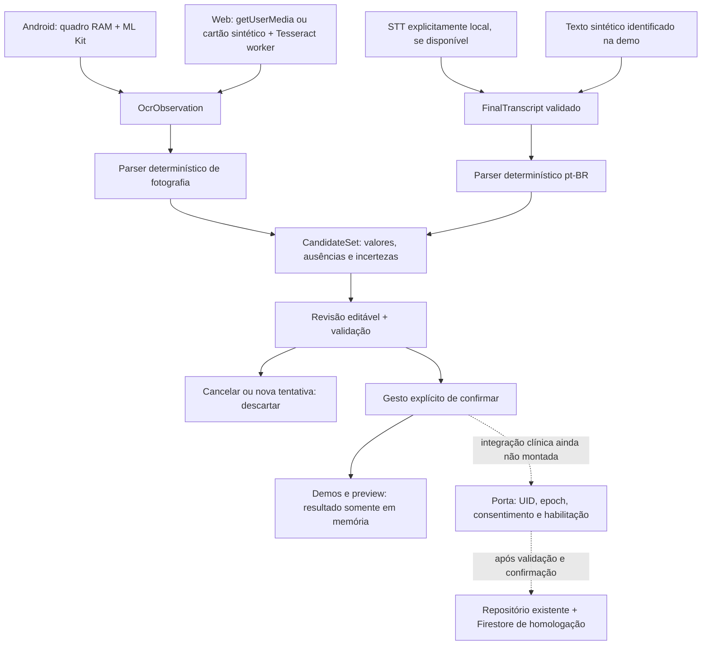

# Aferi — guia de validação e passagem para staging

> **Atualização posterior ao levantamento, em 27/10/2026:** o autor autorizou a
> entrega Git para staging. O código local foi versionado na feature
> `feature/task-19-demo-status` (`09eea48` e `616f8d2`), junto aos documentos deste
> ciclo. Consultar o PR dessa feature para estado de CI/merge e [tasks.md](../tasks.md)
> para o registro de entrega. As seções de inventário abaixo são o retrato
> anterior ao envio, mantido para rastreabilidade; não significam que se deve
> repetir commits já realizados. Não houve habilitação clínica, mudança na
> configuração Vercel ou publicação Firebase por esse versionamento.

Levantamento de **27/10/2026**, sobre o workspace da branch
`feature/task-19-demo-status`. Este guia é uma análise do estado disponível;
não representa aceite da Fase 2. Nesta etapa foi criado somente este documento:
sem alteração de código, caixas de tarefas, configuração, commit, push, merge,
deploy, instalação de pacotes ou operação em serviços de produção.

**Já é possível demonstrar:** parser pt-BR, interpretação de fotografia com
entradas rotuladas sintéticas, revisão/correção/cancelamento e confirmação em
memória; Tesseract/LSTM real lendo um cartão sintético no navegador; formulário
manual reutilizado em cliente isolado. **Ainda não está comprovado:** OCR de
display físico, captura Android, STT local positivo ou persistência assistida
integrada. As telas de avaliação não estão nas rotas do produto.

**Primeira barreira de segurança para staging conectado:** identificar e comprovar
um Firebase de homologação separado do de produção. O alias `staging` existente
não basta. Antes de publicar o trabalho, ele também precisa ser revisado e
commitado: atualmente está no workspace, não nas branches remotas. Para publicar
as demos há outra diferença: o build Vercel atual exporta o app principal, não
os clientes de avaliação. As seções 5 e 6 detalham esses caminhos.

## Índice

1. [O que foi desenvolvido e o alcance da evidência](#1-o-que-foi-desenvolvido)
2. [Estado das tarefas e pendências](#2-estado-das-tarefas-e-pendências)
3. [Como executar e testar: Web, Android, automação e staging](#3-como-executar-e-testar)
4. [Checklist manual e devolução de resultados](#4-roteiro-de-teste-manual)
5. [Git, CI, Vercel e passagem para staging](#5-como-levar-o-trabalho-para-staging)
6. [Segurança, limites, custos e recuperação](#6-segurança-limitações-e-recuperação)
7. [Demonstração de 5–10 minutos](#7-demonstração-para-o-professor)
8. [Próximas ações: suas e do Codex](#8-próximas-ações)

## 1. O que foi desenvolvido

### 1.1 Fontes e significado de “verificado”

Foram confrontados o Git local, metadados GitHub em leitura, código de `src/`,
`native-modules/`, `demos/`, regras/testes/configurações, [tasks.md](../tasks.md),
[constituição](../constitution.md), [instruções](../CLAUDE.md), [plano legado](../PLAN.md)
e specs de [fotografia](../specs/spec-fotografia.md), [voz](../specs/spec-voz.md)
e [PDF](../specs/spec-relatorio-pdf.md).

As PoCs e os registros iniciais estão em outra frente, preservada no commit
`7fbe13784afd6b8aee0fea2aa8122150836f1028`:
[baseline](https://github.com/RamonMenz/bp-tracker/blob/7fbe13784afd6b8aee0fea2aa8122150836f1028/docs/baseline-legado.md),
[specs](https://github.com/RamonMenz/bp-tracker/blob/7fbe13784afd6b8aee0fea2aa8122150836f1028/docs/revisao-specs.md),
[contratos TASK-03](https://github.com/RamonMenz/bp-tracker/blob/7fbe13784afd6b8aee0fea2aa8122150836f1028/docs/arquitetura-ia.md)
e [relatório das PoCs](https://github.com/RamonMenz/bp-tracker/blob/7fbe13784afd6b8aee0fea2aa8122150836f1028/docs/pocs-fotografia-voz.md).
Não há pasta `pocs/` neste checkout. Os objetos Git existem localmente; por exemplo:

```bash
git show 7fbe137:docs/pocs-fotografia-voz.md
```

Esse comando só lê. Não é preciso trocar de branch ou mesclar a PoC para consultá-la.
O commit também contém esclarecimentos em specs e configurações da PoC que ainda
não foram mesclados; precisam de revisão própria, sem sobrescrever a integração atual.

| Nível de evidência | O que permite afirmar |
|---|---|
| Inspeção de código | Existe implementação de determinada regra; não comprova comportamento de SDK/SO |
| Teste isolado com mocks/doubles | O comportamento funciona nas entradas e eventos fornecidos; não comprova hardware, Firebase real ou reconhecimento |
| Runtime de navegador | O percurso foi executado naquele navegador/perfil, com os limites descritos |
| Aparelho/homologação | Exige execução e inspeção específicas; não inferir a partir de export, prebuild ou testes unitários |

Resultados anteriores disponíveis e conferidos neste levantamento, **sem nova
execução das suítes nesta etapa documental**:

- TASK-19: **691 testes/64 suítes aprovados**, três exports Web offline e seis
  exemplos do parser executados diretamente em Node. Logs temporários disponíveis:
  `/tmp/aferi-task19-tests.log`, `/tmp/aferi-task19-browser.log` e
  `/tmp/aferi-task19-*-export.log`, somente no ambiente do Codex.
- Ensaio Chromium **154.0.8037.57/Linux**: revisão sintética, correção/confirmar/
  cancelar/repetição, manual por Enter, OCR real de cartão sintético **120/80/72**.
  Voz retornou `model-missing`, com **zero chamadas de start** e manual acessível.
- Nesse ensaio, origens/worker instrumentados: zero envios externos, escritas HTTP,
  exceções ou sentinela no console; seis mecanismos de storage vazios nas três
  origens. Isso não inspeciona todo disco, SO ou fornecedor.
- TASK-18: lint/TypeScript raiz e cinco clientes, exports/autolinking, **8 checks Java**
  de cópia de buffers; câmera virtual executou getUserMedia→frame→worker→revisão,
  com tracks encerradas e 3/3 workers fechados. `pagehide` foi disparado por script,
  **simulado**. Câmera virtual não é câmera física.
- Firestore Rules **não executaram nem compilaram no emulador**: o download do
  JAR 1.21.0 falhou. O log `/tmp/aferi-task18-emulator.log` confirma o bloqueio.
- Kotlin/APK **não compilados**: registros de bloqueio no download Gradle e,
  na PoC, React Native via `repo.reactnative.dev`/403. Sem reconhecimento Android
  real ou microfone físico testados nos resultados disponíveis.

Detalhes: [TASK-18](task-18-guardrails.md) e [TASK-19](task-19-acompanhamento.md).
Não somar testes das várias etapas: 691 é o total da última suíte completa, não
691 novos testes. O antigo [STATUS_REPORT.md](STATUS_REPORT.md) é histórico do
legado, de 23/09; seus percentuais não medem a evolução por fotografia/voz.

### 1.2 Como as partes se conectam



O motor lê pixels ou reconhece fala. O parser interpreta a saída sem consultar
histórico ou inventar números. A revisão expõe campos editáveis, unidades,
data/hora, ausências, incertezas e erros. Somente um gesto explícito confirma.
Reconhecer, receber um final, silêncio, confiança ou dizer “salvar” não confirmam.

**Fotografia:** associa SYS/DIA/PUL por rótulos e geometria conservadora ancorada
nos rótulos; trata números acessórios, ausência de pulso, resultados parciais e
conflitos. Não troca campos, corrige dígitos, converte kPa ou completa por histórico.
Acerto com texto/caixas fornecidos mede o parser, não a acurácia do OCR.

**Voz:** “doze por oito” e “cento e vinte por oitenta” geram candidatos 120/80;
decimal coloquial de uma casa pode gerar 135/85; pulso precisa de rótulo.
“Doze por oitenta” e correções/múltiplos pares ficam incertos, sem escolher a última
medição. O decoder aceita somente resultado final pt-BR, com limite de entrada.
O parser não consegue detectar sozinho uma transcrição alucinada pelo STT.

**Persistência:** os tipos/Zod/rules locais aceitam `manual`, `photo`, `voice`.
O repositório revalida a whitelist. `source` representa a origem da criação e é
preservada na edição, inclusive de sessões; não é proveniência individual de cada
número. Não há migração automática de documentos antigos. Índices revisados,
sem mudança necessária nas consultas atuais por `measuredAt`.

A porta assistida preparada usa tentativa, revisão e ticket, trava síncrona e
checagens de UID/identidade da sessão (`epoch`)/consentimento/habilitação antes e
depois de aguardar carregamento. Não aceita fixtures como origem clínica.
**Nenhuma tela atual monta o writer assistido real.** O hook de voz permite
injeção futura da porta; fotografia usa demonstração/preview. A ligação clínica
a auth/consentimento/epoch e ao fluxo fotográfico ainda é trabalho de implementação.

### 1.3 Android, Web e identificação das entradas

| Caminho | Código implementado | Verificação real disponível | Escrita clínica |
|---|---|---|---|
| Produto principal Android/Web | Legado manual; novos tipos e validações locais | Regressão isolada; não houve reensaio conectado completo | O manual do produto tem escrita real; não usar fixtures nele sem homologação |
| `demos/photo-review` | Parser de foto com texto/posições sintéticos; parser de voz com texto sintético; revisão compartilhada | Navegador executado | Nunca; “Confirmar simulação” termina em memória |
| `demos/web-capture` | Câmera/getUserMedia, canvas/PNG RAM, Tesseract LSTM em worker; opção sem câmera gera cartão sintético e roda OCR real | OCR real do cartão e pipeline com câmera virtual; física pendente | Nunca; “Confirmar revisão em memória” |
| `demos/android-capture` | CameraX ImageAnalysis, YUV→NV21 em RAM, ML Kit embarcado, parser e revisão | Prebuild/autolinking/Hermes e buffers Java; Kotlin/câmera pendentes | Nunca; cliente isolado |
| `demos/android-voice` | SpeechRecognizer on-device; suporte e pt-BR instalado verificáveis em API 33+; final→parser→revisão | Testes com portas simuladas, prebuild/bundle; serviço real não testado | Nunca; manual de avaliação também em memória |
| `demos/web-voice` | `processLocally` real/readback + `available` local pt-BR; final ao encerrar→parser→revisão | Negativa real por modelo ausente; STT positivo não comprovado | Nunca; manual de avaliação também em memória |
| PoCs em outra branch | Experimentos originais independentes | Relatório próprio; não equivalem às integrações atuais | Sem writer/salvamento |

API Android 31/32 fica indisponível porque o idioma instalado não é comprovável
pelo método adotado; API 33+ também depende do serviço/modelo do aparelho.
Na Web, API presente não basta: só `available` local permite iniciar. Não há
reconhecedor remoto como fallback nem instalação automática na integração Web.
O botão de instalação de modelo da PoC antiga não existe nesse fluxo atual.

### 1.4 Principais arquivos e responsabilidades

| Arquivo/pasta | Responsabilidade |
|---|---|
| [assisted-entry.ts](../src/domain/assisted-entry.ts), [final-transcript.ts](../src/domain/final-transcript.ts) | Contratos compartilhados e decoder de final; dados de SDK entram como unknown |
| [interpret-photo.ts](../src/domain/interpret-photo.ts) | Interpretação pura de linhas/caixas OCR |
| [interpret-voice-pt-br.ts](../src/domain/interpret-voice-pt-br.ts) | Gramática pura pt-BR; testes de comportamento ao lado |
| [useCandidateReview.ts](../src/features/assisted-entry/useCandidateReview.ts) | Tentativas, edição, schema, confirmação, cancelamento, background e respostas tardias |
| [CandidateReadingReview.tsx](../src/components/bp/CandidateReadingReview.tsx), Photo/VoiceReadingReview | Campos, incertezas, data, controles; edição bloqueada durante confirmação |
| [photo-interpretation-examples.ts](../src/features/assisted-entry/photo-interpretation-examples.ts), telas `*DemoScreen` | Fixtures explicitamente identificadas; não evidenciam reconhecimento |
| [useVoiceReview.ts](../src/features/assisted-entry/useVoiceReview.ts), hooks `useAndroid*`/`useWeb*` | Decoder/parser→revisão; modos fixados por montagem, sem promoção automática a clínico |
| [services/recognition](../src/services/recognition) | Adaptadores por plataforma, coordenadores, leases/timeout, erros seguros e limpeza |
| [tesseract-worker.web.ts](../src/services/recognition/tesseract-worker.web.ts), [safe-worker.js](../demos/web-capture/scripts/safe-worker.js) | Protocolo do worker fixado, buffers e supressão de mensagens brutas |
| [módulo foto](../native-modules/aferi-photo-capture), [módulo voz](../native-modules/aferi-local-voice) | Implementação nativa Expo, permissões e dependências Gradle |
| [confirmed-assisted-reading.ts](../src/features/readings/confirmed-assisted-reading.ts), [assisted-reading-writer.ts](../src/features/readings/assisted-reading-writer.ts) | Porta de confirmação e composição tardia com repositório; preparada, não montada |
| [models.ts](../src/types/models.ts), [reading.schema.ts](../src/features/readings/reading.schema.ts), [readings.repo.ts](../src/features/readings/readings.repo.ts), [firestore.rules](../firestore.rules) | Origens, whitelist, validações, acesso ao SDK e autorização; preservação de documentos/sessões |
| [useSession.tsx](../src/features/auth/useSession.tsx), [useReadings.ts](../src/features/readings/useReadings.ts) | Corrigidos perfil/callback/histórico atrasados de conta antiga; logs de leitura sanitizados |
| [BpNumberInput.tsx](../src/components/bp/BpNumberInput.tsx) | Opções de edição/autocomplete usadas pela revisão; defaults manuais preservados |
| [demos](../demos), [tests/guardrails](../tests/guardrails) | Entradas/configuração de clientes isolados e ensaio instrumentado de navegador |

### 1.5 Dependências e legado

Não foi adicionada dependência npm ao produto raiz; seu lock está preservado.
`package.json` mudou o script de rules para fixar o projeto fictício. ESLint ignora
artefatos gerados. Os clientes Android reutilizam as dependências da raiz; não
instalar versões independentes em cada demo.

| Dependência | Versão e alcance |
|---|---|
| Tesseract.js/core | 7.0.0, lock separado em `demos/web-capture/ocr-assets`; worker LSTM/OEM 1 |
| Dados `eng` | Pacote 1.0.0; `4.0.0_best_int/eng.traineddata.gz`; inglês dos rótulos OCR, não idioma da fala |
| CameraX | 1.5.1 no módulo foto isolado; captura por frame evita API que primeiro salva foto |
| ML Kit Text Recognition latino | 16.0.1, variante embarcada; Gradle declarado, não homologado |
| Voz | APIs do SO/navegador, sem pacote STT pago ou motor remoto adicional |
| Ambiente observado | Node 24.19.0/npm 11.9.0; Expo 57.0.8, RN 0.86.0, React 19.2.3, RN Web 0.21.2; TypeScript 6.0.3/Jest 29.7.0; Firebase JS 12.17.0; Zod 4.4.3 |

O preparo OCR copia somente programa/modelo/licenças estáticos, cerca de 23 MiB
nas variantes disponíveis, com manifesto de hashes; isso não é captura de uso.
Não se adicionou OpenCV ou pré-processamento além das decisões da spec.

O legado mantém suas rotas e formulário: Google login, consentimento/onboarding,
manual, edição, histórico, classificação, tendência, CSV, lembretes, tema e duas
leituras/sessionReadings. Motor/câmera/microfone novos não iniciam no caminho manual.
Autolinking do produto não inclui os dois módulos novos; clientes de avaliação
excluem Firebase/Google Sign-In/coletores. Registros antigos continuam aceitos nos
testes. Não existe medição comparável antes/depois de desempenho nem homologação
de todo o legado conectado, portanto essas garantias ainda exigem validação.

## 2. Estado das tarefas e pendências

Estados abaixo avaliam o alcance integral da tarefa, não a quantidade de código.
“Bloqueada” indica implementação parcial cuja próxima execução depende de ambiente.
**D:** demonstração isolada; **H:** homologação/publicação conectada; **F:** aceite e
fechamento final. Uma pendência H/F não impede mostrar uma demo sem persistência.
“Eu” significa o autor/apresentador; Codex continua responsável por implementar,
corrigir builds/código e inspecionar tecnicamente quando houver acesso ao ambiente.

| TASK | Estado | Evidência disponível | Pendência | Próxima ação | Bloqueia |
|---|---|---|---|---|---|
| 01 | Parcial | Baseline 26/10; 384 testes app e 16 Functions na etapa original | Legado conectado, desempenho, horas/despesas | Eu: fornecer ambiente/controle; Codex: validar | H/F |
| 02 | Parcial | Revisão das três specs; P01 tratada conservadoramente na 11 | TAP original/aceite documental | Eu: fornecer TAP; Codex: confrontar | F; contrato antes de H |
| 03 | Concluída | Desenho e contratos registrados; materializados no código | Não homologou SDKs | Codex: manter contratos nas integrações | — |
| 04 | Parcial | PoC OCR Web real em cartão sintético | Câmera/display/bridge e privacidade reais | Codex: build/inspeção; eu: aparelho | H/F; demo física |
| 05 | Parcial | Adaptadores; indisponibilidade local Web observada | STT positivo/localidade/privacidade | Codex: build/inspeção; eu: serviço/aparelho | H/F; demo de voz real |
| 06 | Não iniciada | Há resultados parciais espalhados; sem fechamento formal | Consolidar habilitação, metas e limites antes da avaliação | Codex | H/F |
| 07 | Bloqueada | RAM/ML Kit/parser/revisão implementados; Java/prebuild/Hermes | Kotlin/APK e câmera física; downloads/build | Codex: compilar/corrigir; eu: disponibilizar aparelho | Android H/F; não D Web |
| 08 | Parcial | Tesseract real sintético e câmera virtual em worker | Câmera/navegadores/displays reais; inspeção interna | Eu: abrir no dispositivo; Codex: inspecionar/corrigir | H/F; não D sintética |
| 09 | Parcial | Parser rotulado/geométrico conectado; testes sintéticos | Corpus/layouts reais e precisão medida | Codex, após amostras minhas | H/F |
| 10 | Parcial | Revisão foto/correção/validar/cancelar/confirmar; browser | Composição clínica e dispositivos | Codex | H/F; não D |
| 11 | Parcial | Tipos/Zod/rules/repo/porta preparados; testes com doubles | Emulador e auth/epoch/consentimento/writer reais | Codex; eu: confirmar projeto H | H, especialmente escrita |
| 12 | Bloqueada | Exclusivamente on-device; pt-BR API33+; testes isolados | Build, serviço/microfone e inspeção em aparelho | Codex: build; eu: aparelho/modelo | Android H/F; voz real D |
| 13 | Parcial | Gate local, parser/revisão; model-missing/zero start reais | STT positivo e cobertura/privacidade | Eu: navegador elegível; Codex: validar | H/F; voz real D |
| 14 | Concluída | Parser puro, 46 testes originais e regressão atual | Não depende de STT para seu aceite puro | Codex: preservar testes | — |
| 15 | Parcial | Final→parser→revisão; simulação/preview; porta injetável | 11–13 e integração clínica | Codex | H/F; não D textual |
| 16 | Não iniciada | Fixtures de software; sem corpus físico comprovado | Dois modelos de aparelho/casos rotulados | Eu: acesso/coleta própria; Codex: protocolo/checagem | F/comparação |
| 17 | Não iniciada | Exemplos sintéticos; sem corpus consentido comprovado | Aprovação aplicável/consentimento e coleta | Eu: autorização/coleta; Codex: protocolo | F/comparação |
| 18 | Parcial | 691/64, correções, browser, inspeção por código | Rules, hardware, H, a11y completa, privacidade real | Codex + execução física minha | H/F; não D limitada |
| 19 | Concluída | Consolidação e roteiro no alcance disponível | Apresentação ainda não realizada; dados de controle ausentes explicitados | Eu: apresentar e registrar | Não bloqueia D |
| 20 | Não iniciada | Protocolo/tecnologias de fotografia definidos | Comparação comum ML Kit × Tesseract e métricas | Codex, após 06/16 | F |
| 21 | Não iniciada | Protocolo de voz definido; sem Whisper.cpp operacional | Comparador e corpus comum | Codex, após 06/17 | F |
| 22 | Não iniciada | Sem comparação executada | Análise e refinamento com separação ajuste/avaliação | Codex | F |
| 23 | Não iniciada | Spec PDF | Modelo/cálculos puros | Codex, se solicitado | F; não D Fase 2 |
| 24 | Não iniciada | Escolha Expo Print na spec | PDF Android e temporários | Codex | F |
| 25 | Não iniciada | Escolha jsPDF/AutoTable na spec | PDF Web | Codex | F |
| 26 | Não iniciada | Critérios PDF escritos | Validação de PDF/legado | Codex + aparelho meu | F |
| 27 | Não iniciada | Relatórios locais são insumos | Redação acadêmica integrada | Codex com fontes/decisões minhas | F |
| 28 | Não iniciada | Reserva opcional no plano | Avaliar somente se houver saldo real | Eu: saldo; Codex: análise | Apenas complemento |
| 29 | Não iniciada | Marco de 24/11 planejado | Entrega e controle real | Eu + consolidação Codex | F |
| 30 | Não iniciada | Especificação do relatório final | Relatório técnico final | Codex + revisão minha | F |
| 31 | Não iniciada | Verificação local 18 como insumo | Aceite final completo | Codex + aparelhos meus | F |
| 32 | Não iniciada | Roteiro parcial 19 | Demo final inclui PDF/comparação, ainda ausentes | Codex: preparar; eu: ensaiar | F |
| 33 | Não iniciada | Marco 08/12 | Entrega oficial | Eu | F |
| 34 | Não iniciada | Marco 15/12 | Ajustes/encerramento | Codex + avaliação minha | F |

### 2.1 Confronto com as caixas do plano

[tasks.md](../tasks.md) marca **03, 14 e 19**; as demais estão abertas. Não foi
encontrada caixa fechada incompatível com o alcance **explicitamente delimitado**:
03 é desenho técnico, 14 parser puro e 19 consolidação disponível. Fechar 19 não
significa que houve apresentação ou que os dados financeiros foram informados.

As caixas binárias não distinguem parcial/bloqueada/não iniciada: 07 e 12 estão
abertas, mas têm código e bloqueio de build; 08–13/15/18 têm avanços locais.
01/02 foram realizadas como levantamento/revisão, conforme informado pelo usuário,
mas os relatórios originais e o plano as mantêm parciais pelos aceites restantes.
Isso é diferença de alcance, não autorização para refazer o que já existe.
**Nenhuma caixa foi alterada neste levantamento.** Também não há evidência de
apresentação em 13/10, corpus físico coletado, comparadores executados, PDF pronto,
horas reais ou despesas/saldo global. Não criar datas/valores para preencher lacunas.

### 2.2 Pendências por finalidade

| Finalidade | Necessário | O que pode ficar fora desse passo |
|---|---|---|
| Testar localmente, sem persistência | Ter este workspace completo, Node/lock, assets e exports; Android requer toolchain/build; emulador requer Java/JAR | Firebase real não é requisito das demos |
| Demonstrar ao professor | Ensaiar no computador de destino, identificar entradas sintéticas, preparar alternativa local; não depender de STT/câmera não homologados | Login/CRUD conectado, APK, comparação/PDF podem ser apresentados como pendências |
| Publicar staging conectado | Commit/PR/checks; Firebase H confirmado; variáveis Preview/OAuth/App Check; rules testadas; build e smoke test; pipeline coerente com o que se quer mostrar | STT pode continuar indisponível; demos não podem ganhar writer por configuração |
| Atender aos critérios de aceite | Requisitos FOT/VOZ nas plataformas declaradas, runtime de privacidade/conta/ciclo de vida/a11y, persistência confirmada em H, corpus e comparação conforme specs | Passar Jest/export sozinho não atende a todos |
| Melhorias que podem esperar | Polimento além do necessário, métricas/indicadores opcionais, observabilidade complementar dentro do saldo | Erros de segurança, confirmação, isolamento e liberação de mídia não são opcionais |

## 3. Como executar e testar

### 3.0 Onde estou e onde digitar

- **Ambiente do Codex:** esta sessão está em `/workspace/bp-tracker`. Esse caminho
  não deve ser copiado como se existisse no seu computador. Logs em `/tmp` também
  pertencem a esta máquina e podem desaparecer.
- **Seu computador:** clone/cópia local, terminal do VS Code ou Terminal; no Windows
  use Git Bash para os comandos Bash deste guia. Instale Git e Node com npm;
  reabra o terminal após instalar. PowerShell exige outra sintaxe para variáveis.
- **GitHub:** repositório, branches, PR, ruleset e Actions; não é o terminal local.
- **Vercel:** projeto, integração Git, configurações/env e deployments Web.
- **Firebase/Google Cloud:** projeto, Auth/Firestore/App Check/OAuth/billing;
  não confundir projeto Firebase com projeto Vercel ou branch Git.

No seu terminal, entre na pasta que você realmente salvou, por exemplo:

```bash
cd ~/Projetos/bp-tracker
git rev-parse --show-toplevel
git branch --show-current
git status --short --branch
node --version
npm --version
```

O caminho é um **exemplo**; no Windows/Git Bash pode ser
`/c/Users/SEU_USUARIO/Projetos/bp-tracker`. `cd` troca de pasta; Enter executa a linha;
Ctrl+C encerra um servidor em execução. Um terminal com servidor aberto deve ficar
aberto; use outro para os demais comandos. A raiz correta contém `package.json`
com `name: bp-tracker`, `tasks.md`, `src/`, `demos/` e `native-modules/`.

**Clonar staging agora não traz a implementação local sem commit.** Primeiro é
necessária a entrega do workspace completo ou o fluxo de commit/push autorizado da
seção 5. Não sobrescreva uma cópia sua com alterações. Se as pastas novas estiverem
ausentes, pare e informe ao Codex branch/commit e os nomes das pastas faltantes.

Use **Node 24.3+**, preferencialmente a linha 24 do ambiente verificado. O CI atual
usa Node 20; há uma incompatibilidade a tratar: Functions declara 20, mas
`firebase-admin` 14.2.0 no lock exige >=22. Essa divergência é trabalho do Codex,
não orientação para você mudar dependências por tentativa.

### A. Web local

#### A1. Instalar uma vez e preparar os três clientes isolados

Na **raiz**, com o workspace completo:

```bash
npm ci
npm --prefix demos/web-capture/ocr-assets ci --ignore-scripts
node demos/web-capture/scripts/prepare-ocr.mjs
```

`npm ci` instala exatamente o lock e substitui `node_modules` existente; não apaga
seu código. A instalação inicial exige rede. Não rode `npm install` em cada demo,
nem atualize versões/locks para “resolver” um erro. O segundo lock instala apenas
o pacote de assets OCR. Nenhum desses comandos precisa de conta Firebase/EAS.

Depois, exporte em cada pasta, conforme os executáveis locais atuais:

```bash
cd demos/photo-review
EXPO_OFFLINE=1 EXPO_NO_TELEMETRY=1 ../../node_modules/.bin/expo export --platform web
cd ../web-capture
EXPO_OFFLINE=1 EXPO_NO_TELEMETRY=1 ../../node_modules/.bin/expo export --platform web
cd ../web-voice
EXPO_OFFLINE=1 EXPO_NO_TELEMETRY=1 ../../node_modules/.bin/expo export --platform web
cd ../..
```

Cada comando deve terminar com `Exported: dist`. `EXPO_OFFLINE` e
`EXPO_NO_TELEMETRY` controlam o tooling; não são um bloqueio de rede do aplicativo.
Esses clientes não exigem `EXPO_PUBLIC_FIREBASE_*`, OAuth ou `.env.local`.

#### A2. Servir e acessar

Abra três terminais na **raiz**, um comando em cada:

```bash
node demos/photo-review/serve.mjs
```

```bash
node demos/web-capture/serve.mjs
```

```bash
node demos/web-voice/serve.mjs
```

| URL no mesmo computador | Acesso e resultado |
|---|---|
| `http://localhost:8096` | Abas “Demonstração de fotografia/voz”. Texto/posições sintéticos; parser, edição, validação e confirmação em memória |
| `http://localhost:8098` | Câmera Web ou “Testar OCR real com cartão sintético (sem câmera)”; motor real, revisão em memória |
| `http://localhost:8100` | “Verificar e começar fala local” ou “Ir para registro manual”; ausência de suporte deve dar alerta e manual, sem start remoto |

Servidor local aplica CSP/Permissions-Policy e aceita apenas GET/HEAD; não salva
formulários. Metro de desenvolvimento não aplica necessariamente esses headers.
Recarregar descarta o resultado em memória. Não abrir `index.html` por `file://`.
No telefone, `localhost` é o telefone, não seu computador. Câmera/microfone Web
exigem HTTPS ou localhost e permissões; estes servidores escutam apenas 127.0.0.1.
Não os exponha por túnel público como atalho de homologação.

#### A3. Legado Web conectado — somente após projeto H comprovado

O `npm run web` da raiz abre **o produto**, não as demos. Ele inicializa Firebase;
login pode criar/atualizar perfil, mesmo sem salvar uma medição. Não executar com
configuração de destino desconhecido. Não há `connectFirestoreEmulator`/
`connectAuthEmulator` na inicialização atual: iniciar emuladores ao lado do app
**não redireciona** o app automaticamente.

Após a checagem da seção 5, crie `.env.local` no editor usando
[.env.example](../.env.example), exclusivamente com valores de homologação. Não
cole valores no chat. Nomes obrigatórios de [app.config.ts](../app.config.ts):

```dotenv
# Valores abaixo são fictícios e NÃO criam uma conexão funcional.
EXPO_PUBLIC_FIREBASE_API_KEY=CHAVE_PUBLICA_FICTICIA
EXPO_PUBLIC_FIREBASE_AUTH_DOMAIN=aferi-hml-exemplo.firebaseapp.com
EXPO_PUBLIC_FIREBASE_PROJECT_ID=aferi-hml-exemplo
EXPO_PUBLIC_FIREBASE_APP_ID=1:000000000000:web:exemplo
EXPO_PUBLIC_FIREBASE_MESSAGING_SENDER_ID=000000000000
EXPO_PUBLIC_GOOGLE_WEB_CLIENT_ID=000000000000-exemplo.apps.googleusercontent.com
```

O client ID Web é exigido pela configuração inclusive no export Web. Opcionais:
`EXPO_PUBLIC_FIREBASE_VAPID_KEY`, `EXPO_PUBLIC_APPCHECK_RECAPTCHA_SITE_KEY`,
`EXPO_PUBLIC_SENTRY_DSN`. Não definir DSN de produção para testes. Sem VAPID,
push Web não está disponível; App Check depende da política efetiva do projeto.
`EXPO_PUBLIC_APPCHECK_DEBUG_TOKEN` é credencial de desenvolvimento, só local e
quando necessário, nunca em Preview/Production/EAS/CI; não incluir seu valor aqui.

Então, na raiz, **somente com destino H validado**:

```bash
npm run web
```

Abra a URL que Expo imprimir, não uma URL presumida. Login, consentimento,
registro manual/histórico/ajustes são as rotas existentes. Não procurar botões
de captura novos no produto: ainda não foram montados. Teste com contas de teste
suas no projeto H, sem identidade de pacientes e sem alegar anonimato do Google.

#### A4. Erros comuns

| Sintoma | Diagnóstico/ação |
|---|---|
| `npm`/`node` não encontrado | Instalar Node, reabrir terminal; informar versões/OS ao Codex |
| `ENOENT package.json`, binário Expo ausente | Conferir `git rev-parse --show-toplevel`, pasta atual e instalação na raiz |
| `Variável de ambiente ausente` na demo | Pode ter executado Expo na raiz; demos têm app.json próprios e não exigem Firebase |
| `EADDRINUSE` | Já existe servidor naquela porta; encerrar o seu com Ctrl+C. Não matar processos desconhecidos |
| 404 em JS/worker/modelo, tela vazia | Verificar export `dist`, preparo OCR e aba Network; informar caminho do recurso e status sem payload |
| Câmera negada/insegura/ocupada | Conferir localhost/HTTPS e permissões da origem; fechar outro app; nova tentativa só por gesto |
| `model-missing`/local indisponível na voz | Resultado esperado em ambiente sem pt-BR local; usar manual/texto sintético. Não desabilitar o gate |
| `permission-denied` no produto | Conferir Auth/provedor Google, regras/App Check e projeto H; não relaxar regras de produção |

### B. Android no dispositivo com Expo Dev Client

#### B1. Ferramentas e isolamento

No **seu computador**, instalar Android Studio/SDK e platform-tools (`adb`), JDK
compatível com o Gradle do projeto, Node/Git. A PoC resolveu JDK 17, Gradle 9.3.1,
SDK/target 36, Build-Tools 36.0.0, NDK 27.1.12297006 e Kotlin 2.1.20. São parâmetros
observados de geração, não build homologado; conferir o solicitado pelo Gradle e
enviar erro ao Codex antes de trocar versões. Rede inicial precisa permitir os
repositórios Gradle/Maven/Google/RN. Não desligar TLS/proxy para contornar bloqueios.

No telefone: habilitar opções do desenvolvedor e depuração USB; conectar cabo de
dados e aceitar a autorização. `adb devices` deve mostrar um aparelho autorizado;
não enviar serial na devolução. Para voz, preferir Android API 33+ com serviço
on-device e pt-BR instalado verificável. Nem todo aparelho com microfone atende.

**Não usar Expo Go nem disparar EAS Build.** Cada cliente precisa de um Dev Client
nativo próprio. O APK antigo do produto não contém esses módulos. Os pacotes
isolados não usam Firebase, `.env.local`, google-services ou login.

#### B2. Primeiro build local — passos futuros, ainda não aprovados no ambiente

Na raiz, depois de `npm ci`, para **foto**:

```bash
cd demos/android-capture
../../node_modules/.bin/expo prebuild --platform android --no-install
../../node_modules/.bin/expo run:android --device --port 8097
```

Para **voz**, em outro terminal que começa na raiz:

```bash
cd demos/android-voice
../../node_modules/.bin/expo prebuild --platform android --no-install
../../node_modules/.bin/expo run:android --device --port 8099
```

Não rodar prebuild na raiz por engano. Não usar `--clean` para resolver falhas:
poderia descartar ajustes nativos. Prebuild gera estrutura Android; run:android
compila/instala localmente e inicia Metro. Não é build pago em nuvem. Primeiro
objetivo é conseguir compilar; se Kotlin falhar, **o Codex corrige o código** a
partir do erro sanitizado. Não há APK pronto garantido pelos resultados atuais.

Depois de instalado, para reiniciar só o JavaScript, na **pasta da respectiva demo**:

```bash
# demos/android-capture
../../node_modules/.bin/expo start --dev-client --localhost --port 8097
```

```bash
# demos/android-voice
../../node_modules/.bin/expo start --dev-client --localhost --port 8099
```

Com USB, se necessário, em terminal com platform-tools no PATH:

```bash
adb reverse tcp:8097 tcp:8097
adb reverse tcp:8099 tcp:8099
```

No telefone abra **Aferi — captura em avaliação**
(`com.ramonmenz.afericapturetest`) ou **Aferi — voz local em avaliação**
(`com.ramonmenz.aferivoicetest`), selecionando o servidor de desenvolvimento se
solicitado. Resultado esperado: tela isolada, sem login, indicação de avaliação;
revisão e confirmação somente em memória. O manual está no cliente de voz.
Alterar Kotlin/Java/Gradle/manifest/autolinking exige novo build nativo; reiniciar
Metro não atualiza o APK. Mudanças JS precisam de bundle/Metro atualizado.

#### B3. Produto Android e problemas comuns

Testar o legado Android conectado exige outro Dev Client, o pacote do produto
`com.ramonmenz.bptracker`, configuração Firebase/OAuth **de H**,
`GOOGLE_SERVICES_JSON` apontando para arquivo local H (ou google-services.json
ignorado), client ID Web coerente, fingerprints OAuth e App Check. Isso não é
necessário para as demos. Um build existente pode conter configuração de produção:
não usá-lo para fixtures até verificar destino. `GOOGLE_SERVICES_PLIST` é o
equivalente iOS, fora do escopo Android deste ciclo.

| Problema | O que devolver ao Codex |
|---|---|
| `unauthorized`/nenhum device | OS, cabo/USB autorizado ou não; sem serial |
| Gradle download/403/SDK ausente | Comando, fase, domínio/status e trecho sanitizado; não trocar libs |
| Erro Kotlin/Java | Arquivo, linha e mensagem do compilador sem caminhos pessoais/segredos |
| Native module não encontrado | Nome do pacote instalado e se recompilou a demo correta; QR/Metro não acrescenta módulo |
| Não conecta ao Metro | Porta, reverse e se abriu o cliente isolado; não usar túnel como evidência de privacidade |
| Voz indisponível | API Android, versão geral do serviço e estado do pt-BR; pode ser resultado legítimo |

Roteiros especializados: [TASK-07](task-07-captura-android.md) e
[TASK-12](task-12-voz-android.md). Não atribuir ao usuário a correção dos bindings.

### C. Testes automatizados e emuladores

Na **raiz**, com Node/dependências instaladas, sem Firebase real:

```bash
npm run lint
npm run typecheck
npm test -- --runInBand
```

Para a gramática de voz isoladamente:

```bash
npm test -- --runInBand src/domain/interpret-voice-pt-br.test.ts
```

TypeScript dos cinco clientes, ainda da raiz:

```bash
node node_modules/typescript/bin/tsc --noEmit -p demos/photo-review/tsconfig.json
node node_modules/typescript/bin/tsc --noEmit -p demos/web-capture/tsconfig.json
node node_modules/typescript/bin/tsc --noEmit -p demos/web-voice/tsconfig.json
node node_modules/typescript/bin/tsc --noEmit -p demos/android-capture/tsconfig.json
node node_modules/typescript/bin/tsc --noEmit -p demos/android-voice/tsconfig.json
```

Automação de navegador exige Node 24 e **Chromium no PATH**, verificada em Linux.
No Windows/macOS ela pode exigir adaptação pelo Codex; não é requisito para você
usar as demos manualmente. Fechar antes os servidores manuais das portas
8096/8098/8100; os scripts abrem e encerram seus próprios processos:

```bash
node tests/guardrails/browser-runtime.mjs
node tests/guardrails/virtual-camera.mjs
```

CDP usa 9234/9235; `AFERI_T18_CDP_PORT=9236` pode trocar a porta do primeiro.
Segundo script usa dispositivo de vídeo **virtual**. O primeiro não improvisa
áudio: se encontrar modelo local disponível em vez da negativa esperada, falha
pedindo teste controlado. Não mudar expectativas para declarar STT comprovado.
Não gera screenshots/HAR/áudio; resultados JSON são técnicos/sintéticos.

**Security Rules:** instalar Java 21+ e ter rede/cache para o JAR. Na raiz:

```bash
java -version
npm run test:rules
```

O script atual equivale a:

```bash
npx --no-install firebase emulators:exec --only firestore --project demo-aferi-task11 "npx --no-install jest --config jest.rules.config.js"
```

`demo-aferi-task11` é fictício; suíte fixa `127.0.0.1:8080`, tokens de contas
sintéticas e provedor Google simulado. Não usar um ID real em seu lugar.
Ela cobre origens/whitelist/contas/sessões e não testa login Google real.
`npm test` da raiz **não inclui** essa suíte. JAR não baixou nas tentativas
anteriores: zero testes de rules executados, não “todos aprovados”. Se falhar,
devolver código/status de download ou primeiro erro sanitizado; não publicar regras.

Functions é projeto separado; testes/build locais, não deploy:

```bash
npm --prefix functions ci
npm --prefix functions run build
npm --prefix functions test -- --runInBand
```

Sua execução anterior na TASK-01 aprovou 16 testes. A divergência Node 20/SDK
>=22 deve ser resolvida pelo Codex para validar CI/runtime; não há nova aprovação
de Functions nesta análise. Não usar `npm --prefix functions run serve/deploy`
indiscriminadamente: seus scripts não fixam um projeto de destino.

**Emulador de UI completa:** não existe pronto neste código. O firebase.json não
configura Auth Emulator, e o app não conecta SDKs a emuladores. É trabalho futuro
do Codex preparar isso, se necessário. Não iniciar Functions/scheduler para testar
apenas parser/revisão. Os checks Java e comandos de autolinking estão documentados
na TASK-18; eles não substituem compilação Android nem teste de câmera.

### D. Web publicada em staging

Este cenário **não foi executado** nas verificações locais e não está configurado
de forma comprovada. Primeiro cumprir seção 5; depois, no navegador, abrir a URL
do deployment cujo **branch, commit e ambiente** foram conferidos no painel Vercel.

Com a configuração versionada atual:

- `npm ci` → `npx expo export -p web` na raiz → `dist`;
- exige as seis variáveis obrigatórias de A3 em **Preview/staging** no build;
- publica o app legado autenticado, não os servidores 8096/8098/8100 nem as telas
  isoladas. Não existe `EXPO_PUBLIC_DEMO_MODE` ou rota pública de demonstração pronta;
- não atualiza rules/índices/Functions ou APK; não habilita os novos módulos nativos;
- não herda os headers dos `serve.mjs` das demos. O vercel.json atual tem headers
  de assets/FCM e rewrite SPA, sem as políticas específicas das demos.

Para ver demos remotamente será necessária configuração separada de publicação
dos seus exports, preparada pelo Codex em tarefa futura e revisada. Com H ausente,
somente esse artefato isolado sem Firebase pode ser candidato a demo publicada;
não publicar o app principal com variáveis de produção ou valores fictícios
apresentados como homologação. Até a configuração estar pronta, a alternativa
executável é **Web local**. Não prometer URL de demo a partir do merge atual.

## 4. Roteiro de teste manual

Use sempre dados sintéticos. “Esperado” é um critério de teste, não resultado já
obtido em seu aparelho. Marcar cada caso como **passou / falhou / indisponível /
não testado**, com data real e ambiente. **UI** indica o que você observa;
**técnica** exige instrumentação/inspeção do Codex. Não exportar dados de usuários
para fabricar corpus ou pedir a outra pessoa que dite valores pessoais.

| Nº | Ação executável | Resultado esperado | Evidência a registrar / camada |
|---|---|---|---|
| 1 | Em 8100, ir direto ao manual sem iniciar voz; preencher 120/80, pulso 72; confirmar | Sem pedido de microfone; confirmação claramente em memória | Texto do estado e se houve pedido de permissão; UI. Não comprova CRUD |
| 2 | Em H confirmado, entrar no produto com conta de teste; manual com câmera/mic negados | Login/consentimento e manual operam independentemente das modalidades; criar uma leitura só após gesto | Conta rotulada A, horário e contagem antes/depois; UI + consulta técnica no projeto H |
| 3 | Ainda em H, editar nota/data/números de leitura sintética; consultar histórico/tendência/CSV; sessão de duas leituras; tema/lembretes | Legado e documentos sem sessionReadings preservados; média/detalhes/export coerentes; não mudar source na edição | Caso por função, passou/falhou; CSV só sintético. Push real e a11y exigem casos próprios; não ativar scheduler de produção |
| 4 | Em 8096, fotografia → candidatos completos; depois layout/acessórios/parcial/números sem rótulo | Valores identificados corretamente; ausências/incertezas visíveis; sem completar pelo histórico | Nome do cenário e resultado por campo; **entrada de texto/caixas sintética, sem OCR** |
| 5 | Em 8098, “Testar OCR real com cartão sintético (sem câmera)” | Worker lê pixels do cartão; revisão esperada 120/80/72 | Motor/navegador e acerto por campo; **OCR real de pixels sintéticos**, não display |
| 6 | Em 8098/aplicativo Android isolado, permitir câmera e enquadrar cartão próprio impresso/tela com SYS 120/DIA 80/PUL 72; capturar | Uma captura, resultado revisável, recurso encerrado | OS/navegador ou pacote/API e campos certos/ausentes; **câmera real de cartão sintético**. Kotlin/build primeiro |
| 7 | Se possuir aparelho de pressão próprio para avaliação, testar display controlado sem usuário/paciente e anotar rótulo esperado separado | Resultado comparável ao display; erro/ausência declarado sem inventar valor | Modelo genérico, luz/ângulo e acerto por campo; não mandar fotografia identificável. Não contar como corpus validado automaticamente |
| 8 | Em 8096, voz → “Simular doze por oito”; depois digitar “cento e vinte por oitenta” e interpretar | Ambas dão candidatos 120/80, sem confirmação automática | Campo por campo e gesto necessário; **texto sintético, sem STT** |
| 9 | Usar “treze vírgula cinco por oito vírgula cinco, pulso setenta e dois”; depois “pulso setenta e dois” | 135/85/72 no primeiro; só pulso 72 no segundo; sem preencher par ausente | Valores/ausências e rótulos; parser textual |
| 10 | “doze por oitenta”; “doze por oito, não, quatorze por nove”; cenário de parcial/silêncio | Escala mista/múltiplos pares ficam incertos; parcial não habilita confirmação clínica | Motivo exibido, campos vazios, botão; não escolher última medição |
| 11 | Em cliente de voz real isolado e previamente elegível, verificar suporte; ditar frases sintéticas de 8/9 e terminar fala | Só final após encerramento chega ao parser; permissão explícita; confirmar continua em memória | Serviço/API/pt-BR disponível, acerto por campo, liberação. Se indisponível, registrar isso, não substituir por transcrição injetada |
| 12 | Corrigir SYS para 125, pulso/data/nota sintética; tentar SYS 40, DIA >=SYS, data futura | Erros impedem confirmar; corrigir não troca/escala outros campos; resultado final reflete edição | Valores sintéticos esperados versus exibidos e validação; UI |
| 13 | Cancelar em revisão; nova tentativa; cancelar durante permissão/preparo/reconhecimento | Campos/resultado anteriores descartados; nenhuma confirmação; nova tentativa não recupera candidato cancelado | Etapa de cancelamento e estado ao aguardar/voltar; UI + instrumentação para corrida tardia |
| 14 | Negar câmera/microfone; revogar em configurações; tentar API/idioma indisponíveis | Aviso acessível, saída manual; não solicitar novamente nem cair no remoto sem gesto | Código fixo/mensagem, contagem de pedidos; UI. Localidade exige técnica |
| 15 | Reconhecer/interpretar e aguardar sem tocar confirmar; dizer/digitar “salvar”; encerrar/silêncio | Nenhuma confirmação nem escrita/fila | UI mostra revisão; **zero writer/HTTP/Firestore exige técnica**, UI sozinha não basta |
| 16 | Tocar rapidamente iniciar/capturar/terminar/confirmar; mudar de modalidade enquanto processa | Uma tentativa; não duplicar; confirmação travada, campos/data sem edição durante envio | Contagem de sessões/confirmações observadas; testes controlados verificam promessas tardias |
| 17 | Conceder permissão após cancelar; sair/voltar rápido; callback de data antigo | Nenhuma resposta antiga restaura ou altera tentativa nova | Sequência exata e estado; eventos difíceis exigem teste isolado/instrumentação |
| 18 | Home, trocar aba/app, bloquear tela durante captura/revisão; voltar | Câmera/mic/worker encerram; revisão descartada; não reinicia sozinho | Indicadores e estado; **background real**, diferente do pagehide simulado nos scripts |
| 19 | Em voz, interromper com áudio/ligação, Bluetooth/leitor de tela; silêncio/ruído sintéticos controlados | Encerra/reporta erro seguro; não cria medição automaticamente nem aceita TTS próprio como confirmação | Tipo de interrupção e código fixo; microfone/liberação/localidade exigem técnica |
| 20 | Só em H/integrado: trocar A→B/logout durante histórico e, quando implementado, captura/revisão/carga/ACK | Nenhum dado de A em B; contexto antigo não autoriza nova escrita; ACK antigo não restaura sucesso | Rótulos A/B sem email/UID; queries/writer e rules inspecionados. Hoje demos não têm contas e a integração assistida real não está montada |
| 21 | Navegar Tab/Shift+Tab/Enter/Espaço; zoom/fonte 200%, claro/escuro e leitor de tela | Campos/alertas/erros/ações compreensíveis, foco operável, sem cortes, alvos adequados | OS/browser/tecnologia e controle que falhou; UI. Contraste exige medição |
| 22 | Repetir sucesso/erro/cancelamento/background; inspecionar storage/rede/logs antes/depois | Sem mídia/transcrição/valores clínicos persistidos ou enviados; apenas programa/modelo estático permitido | Codex: contagens, nomes de APIs/arquivos técnicos/códigos seguros; sem payloads, dumps ou mídia |

### 4.1 O que a interface não prova

Botão inativo, indicador apagado, galeria vazia e modo avião **não comprovam**
privacidade. Você pode comprovar experiência de uso e resultado por campo;
Codex deve complementar com:

- Web: Network da página e workers, destinos/métodos sem corpo; IndexedDB,
  Cache API, SW, local/sessionStorage, OPFS e referências/tracks/worker. Heap,
  snapshots e HAR podem conter dados de captura: não gerá-los com dados reais.
- Android: sandbox/cache/files e permissões do **pacote isolado**, ciclo de vida,
  logs e rede do app/SDK e do serviço de voz quando viável. Só olhar UID do app
  não inspeciona o fornecedor do STT. Sem acesso técnico suficiente, declarar a lacuna.
- Escrita: spies/testes isolados para chamadas antes de confirmar; em H, regras,
  contagens de documentos e fila offline com contas de teste. Browser das demos
  sem Firebase não comprova fila offline do produto.

O produto Web já usa cache persistente de Firestore/Auth; dados clínicos
**confirmados** podem persistir conforme o legado. Isso é distinto da proibição de
reter mídia/transcrição/candidatos não confirmados. As demos isoladas não usam
esse cache. No Android, Firestore JS com getFirestore não é prova de persistência
offline em disco. Não apagar cache com escrita pendente para “consertar” conta.

### 4.2 Como devolver resultados

Use uma linha por caso, por exemplo:

```text
Data real | caso 10 | Web/Chrome versão X, OS Y | texto sintético
resultado: passou | SYS/DIA vazias | motivo: escala incerta | escrita: não inspecionada
```

Para falha: comando/etapa, esperado/obtido, versão geral, código fixo e se conseguiu
cancelar/liberar. Nos casos sintéticos pode citar o identificador do cenário;
não enviar transcrição de uso, foto/áudio, nomes de pacientes, email, serial, UID,
tokens, `.env.local`, google-services ou logs completos. Um screenshot só é
apropriado se for estritamente da tela sintética sem conta/identificadores;
prefira descrição textual. Resultado “indisponível” é evidência válida de cobertura.

## 5. Como levar o trabalho para staging

### 5.1 Git e remoto: o que foi conferido

| Item | Estado observado em 27/10 |
|---|---|
| Branch local | `feature/task-19-demo-status`, sem upstream configurado |
| HEAD local | `7d72cb3347dca04bde9b8a706f523a6da245dea2`, igual ao staging remoto consultado |
| Commits novos de implementação locais | **Zero** em relação ao staging consultado. Há muitos arquivos modificados e não rastreados; mudanças ainda não são commits |
| Outras branches locais TASK-07/08/09/10/11/12/13/14/15/18 | Apontam para o mesmo 7d72cb3. Não contêm uma série independente de commits por tarefa; o workspace sujo foi levado entre branches |
| `main` remoto | `3f8220f7c89831f917081f4abd84c9b9cacb6bef`, protegido; default branch GitHub |
| `staging` remoto | `7d72cb3347dca04bde9b8a706f523a6da245dea2`, protegido |
| Frente PoC remota | `feature/pocs-fotografia-voz` em 7fbe137; um commit além da base local, com PoCs/docs/config/specs. Ainda não mesclada |
| Branch atual no remoto | Não apareceu na listagem GitHub; esta implementação não está enviada |
| Remote-tracking local | Nenhuma ref `origin/*` materializada; refspec configurado só para main. Isso não significa que staging remoto não exista |

Metadados consultados pelo conector GitHub em leitura: [branches](https://api.github.com/repos/RamonMenz/bp-tracker/branches?per_page=100),
[ruleset](https://github.com/RamonMenz/bp-tracker/rules/25905687) e runs da branch
staging. Não se executou fetch/push/merge nesta análise. A leitura da proteção
clássica de branch retornou **403 por permissão da integração**; o ruleset abaixo
foi lido com sucesso. Eventuais proteções adicionais clássicas precisam do painel.

### 5.2 Ruleset e CI efetivos

Ruleset **25905687, ativo**, aplica a `main` e `staging`, sem bypass configurado:

- Proíbe exclusão e non-fast-forward/force push.
- Exige PR, resolução de conversas e base atualizada antes do merge.
- Exige os checks com estes nomes exatos:
  `App (lint, typecheck e testes)`, `Cloud Functions (build e testes)` e
  `Security Rules (emulador do Firestore)`.
- Número mínimo de aprovações de review: 0; isso não dispensa PR/checks. Há regra
  de aprovação extra para alterações não atribuídas; cumprir o que a UI exigir.
- Permite merge, squash e rebase; escolher método conforme política da equipe.

[ci.yml](../.github/workflows/ci.yml) roda em **todo PR** e push em `main`;
push direto em staging não está entre seus gatilhos. Consulta de runs com
`branch=staging` retornou zero; não é prova de ausência de CI em PRs para staging,
pois eles são associados à branch de origem. Este trabalho sujo não foi testado
pelo CI remoto. Os três jobs atuais não incluem export dos clientes, runtime de
navegador, instalação dos assets OCR ou build Kotlin; aprovação do CI não valida
essas camadas automaticamente.

[eas-build.yml](../.github/workflows/eas-build.yml) é manual, puxa ambiente EAS
development e dispara build Android. Não executá-lo para este handoff/demo;
ele não constrói automaticamente os dois clientes isolados e pode consumir cota.

### 5.3 Comprovar o ambiente de homologação antes de publicar

O arquivo [.firebaserc](../.firebaserc) contém **alias `staging` →
`bp-tracker-92558`**. ID de projeto é identificador público, não credencial;
o nome do alias não certifica finalidade. A configuração **efetiva do app** vem de
`EXPO_PUBLIC_FIREBASE_PROJECT_ID`/demais variáveis no build, via app.config,
e não desse alias. Não havia essa variável configurada no processo da análise.
Não foram lidos arquivos de segredos nem painéis Vercel/Firebase; **não foi possível
comprovar se esse ID é produção ou homologação**, nem confrontá-lo com um deploy
efetivo. Tratar como destino não autorizado para testes até verificar.

No **painel Vercel**, você deve conferir, sem compartilhar valores:

1. Projeto ligado a `RamonMenz/bp-tracker`, Root Directory/build/Output efetivos.
2. **Production Branch = main**, domínio de produção ligado só a deployments de main.
3. Staging usa **Preview** (ou ambiente customizado explicitamente isolado), com
   overrides da branch `staging`. Não chamar Preview de “Production” por ser público.
4. Regra que constrói apenas main/staging. Foi informada pelo usuário; **não consta
   no vercel.json** e não foi verificada no painel. Conferir Git/Deployment
   settings ou Ignored Build Step; não remover filtro para gerar Preview de feature.
5. Todas as seis variáveis de A3 em Preview/staging vêm do projeto H. Conferir
   branch overrides que prevalecem sobre Preview genérico; não duplicar Production.
   VAPID, OAuth, App Check e DSN, se usados, também pertencem a H.
6. Variáveis `EXPO_PUBLIC_*` são embutidas no bundle no build. Mudar no painel
   exige novo build; não atualiza artefato já exportado. Não imprimir env no log.

No **painel Firebase/Google Cloud**, conferir IDs reais (não apelidos) de H e
produção, distintos, e comparar com o ID efetivo do Preview/staging:

- Auth Google habilitado, domínio HTTPS de staging autorizado; OAuth client e
  authDomain coerentes. Redirect/origem necessários dependem da configuração
  de login; usar Console, não inventar client ID.
- Firestore existente em H; rules/índices correspondentes; não copiar dados clínicos.
- App Check/reCAPTCHA com domínio H e política conhecida; não usar debug token
  no build publicado nem desabilitar proteção de produção para liberar staging.
- Projetos Android/config e fingerprints H separados/coerentes se testar nativo.
- FCM/lembretes/coletores em H, sem tokens ou destinos de usuários reais. Manter
  integrações opcionais desligadas até configurar e validar.

Devolver ao Codex somente “IDs conferidos e distintos: sim/não”, ambiente/branch,
domínio público de staging se apropriado e bloqueio sanitizado. Um ID público de
projeto pode ser comparado tecnicamente quando necessário; chaves/tokens nunca.
Antes do primeiro login (que já escreve perfil), confirmar a igualdade
`Firebase do bundle de staging = H` e desigualdade com produção. Codex pode
inspecionar apenas esse identificador público do artefato sem despejar a configuração.

### 5.4 Revisar, commitar e enviar — roteiro futuro, não executado

Faça estes passos no **workspace que contém os arquivos**, não em um clone vazio.
O Codex pode executar a preparação técnica e, com solicitação específica futura,
os commits/push/PR. Não é sua obrigação editar Kotlin ou resolver conflitos.

1. Conferir novamente a branch e salvar o inventário revisado de arquivos. Não
   trocar para main/staging com alterações sujas, nem usar reset/clean/stash
   como substituto de backup. `git stash` sem `-u` nem inclui arquivos novos.
2. Atualizar referências em leitura, quando for executar o fluxo. Neste checkout
   o refspec só busca main, por isso usar referências explícitas:

   ```bash
   git fetch --no-tags origin main:refs/remotes/origin/main staging:refs/remotes/origin/staging feature/pocs-fotografia-voz:refs/remotes/origin/feature/pocs-fotografia-voz
   git status --short --branch
   git log --oneline origin/staging..HEAD
   git diff --stat origin/staging
   git ls-files --others --exclude-standard
   git diff --check
   ```

   No estado observado, o log de commits novos é vazio, mas o diff e a lista de
   não rastreados não são. Não fazer merge das branches locais das tarefas: não
   há commits novos nelas a reunir. A frente PoC é independente: não duplicar
   seu commit/copiar pocs inteiro por ter reutilizado seu código. Qualquer merge
   posterior precisa conciliar specs/CLAUDE/tasks e preservar os módulos atuais.
3. Revisar no editor/Source Control todos os arquivos candidatos. Excluir `.env*`
   com valores, google-services, service accounts, tokens/keystores, dumps,
   corpus/imagens/áudio, builds/android gerado, `.expo`, `node_modules`, `dist`,
   logs e `public/ocr` binário gerado. Locks de código/asset e fontes de módulos
   **devem** entrar. Não excluir `native-modules/.../android/src` confundindo-o
   com `demos/.../android` gerado.
4. Atenção: o `.gitignore` atual ignora `.env.local`/`.env.*.local`, mas não é
   garantia contra todo nome de `.env`, corpus ou build de módulo. Não usar
   `git add .` ou `git add -A`. `git diff` pode revelar valores se um arquivo
   sensível entrou: revisar localmente, sem colar o conteúdo no chat.
5. Repetir testes/checks apropriados da seção C, rules no emulador e exports das
   demos. Codex deve corrigir falhas e conferir Node/Functions/CI. Não marcar
   hardware como aprovado pelo CI. Commitar mudanças coordenadas de
   tipo/schema/rules/repo/testes juntas; hooks/componentes compartilhados também
   precisam de seus contratos, não uma divisão artificial por branch antiga.
6. No VS Code Source Control, selecionar **cada arquivo revisado** para staging
   (o “stage” do Git significa preparar commit, não publicar o ambiente staging).
   Equivalentes para arquivos individuais e mudanças já rastreadas:

   ```bash
   git add -p
   git add -- src/domain/interpret-voice-pt-br.ts src/domain/interpret-voice-pt-br.test.ts
   git add -- docs/guia-validacao-e-staging.md
   git diff --cached --stat
   git diff --cached --name-only
   git diff --cached --check
   ```

   Esses exemplos **não selecionam toda a implementação**. O Codex deve preparar
   o manifesto completo e revisar o diff de cada grupo antes do commit, evitando
   exigir de você adivinhar dependências entre os 100+ arquivos novos/alterados.
   Conferir diff staged no editor, inclusive arquivos novos. Depois de aprovação
   específica, por exemplo para uma entrega coordenada:

   ```bash
   git commit -m "feat(assisted-entry): prepara avaliação local com revisão segura"
   git log --oneline origin/staging..HEAD
   git status --short --branch
   ```

   Ajustar título ao conteúdo efetivamente selecionado; documentação pode ser
   outro commit. Não repetir commit se ele já existe: verificar log/diff/status
   antes. O hash base 7d72cb3 nunca identificará essa entrega nova.
7. Depois dos commits completos, se origin/staging avançou, atualizar **a feature**
   via merge normal de origin/staging, resolver conflitos pelo Codex e repetir
   verificações afetadas. Não fazer rebase/force push nas protegidas. Só enviar
   a branch correta com autorização específica:

   ```bash
   git push -u origin feature/task-19-demo-status
   ```

   Não enviar todas as branches/tags nem push direto para staging/main.

### 5.5 PR, checks e merge

No **GitHub → Pull requests → New pull request**, escolher **base `staging`** e
**compare `feature/task-19-demo-status`**. Conferir a lista de commits e arquivos.
O título/descrição devem dizer implementação parcial, demos sem persistência,
testes executados e pendências físicas/STT/rules; incluir link deste guia.

Como features não geram Preview Vercel pela política informada, revisar com:
diff/testes de CI + execução dos clientes isolados localmente + relatórios e
ensaio sintético. Não exigir uma URL inexistente nem promover feature a produção
para revisão. Se precisar de review remoto das demos, Codex deve preparar um
artefato/configuração separados e revisados, sem writer, preservando a política
main/staging. O build Web de staging só ocorrerá após merge autorizado.

Esperar os **três checks exigidos** ficarem verdes no último commit com base
atualizada e resolver conversas. Se “Expected” persistir, conferir evento/nomes
dos jobs/execução do PR; não remover o check do ruleset. Se rules falhar por JAR,
é falha de ambiente, não aprovação de segurança. Se Functions falhar por Node,
Codex corrige a compatibilidade. Não confiar em um run de commit anterior.

Depois do escopo aprovado e autorização para merge, usar o botão permitido pelo
ruleset no GitHub. Registrar SHA resultante em staging, PR e resultados; não usar
bypass/admin ou force push. Main deve permanecer no SHA anterior até um PR de
promoção separado e autorizado. Fechar este PR não encerra tarefas parciais.

### 5.6 Vercel, regras/índices e smoke test

**Web:** no painel Vercel, acompanhar o deployment de **staging**, validar branch,
SHA do merge, ambiente Preview, saída do build e URL atribuída. Um status “Ready”
não comprova destino Firebase ou módulos novos. O filtro main/staging é uma
configuração externa ainda não verificada; se “Ignored”, conferir essa regra
sem habilitar builds pagos/indiscriminados. Não promover o deployment a Production.

**Demos com H incompleto:** o código atual permite exportar clientes sem Firebase;
o mais simples é demonstrar localmente. Publicação remota exige configuração
específica do export selecionado, dependências/arquivos fora da pasta, headers
CSP/Permissions-Policy/no-store e assets/worker, sem herdar o bootstrap clínico.
Recomendação técnica para tarefa posterior: projeto de demonstração separado,
gratuito e explicitamente sem persistência, ligado ao staging e sem variáveis
clínicas, com configuração revisada. Não basta mudar Build Command no painel:
o vercel.json da raiz também define build/output e pode prevalecer sobre settings.
O Codex deve preparar/validar essa configuração; ela **não foi implementada** aqui.

**Rules:** há mudanças em firestore.rules. Antes de qualquer modalidade conectada,
emulador aprovado e revisão do destino são obrigatórios. **Não houve deploy**.
O ID abaixo é fictício e deve ser substituído pelo ID H comprovado, distinto de
produção; não usar o alias staging nem executar como está:

```bash
# Raiz; somente no passo futuro autorizado, com H comprovado:
npx --no-install firebase deploy --only firestore:rules --project aferi-hml-exemplo
```

**Índices:** firestore.indexes.json não mudou; não é necessário publicar índice
novo apenas pela origem photo/voice. Se a comparação com H mostrar índice
faltante e houver autorização específica:

```bash
npx --no-install firebase deploy --only firestore:indexes --project aferi-hml-exemplo
```

Aguardar índices prontos antes do smoke test. Não seguir links de criação de
índice sem verificar o projeto de destino. Firebase Hosting não é o canal atual:
firebase.json não tem bloco hosting, e Web é Vercel. Não usar comandos antigos
de Hosting do CLAUDE como procedimento para este staging.

**Functions:** nenhuma Function foi alterada nesta frente; não há motivo para
publicá-las para demonstrar parser/revisão. O deploy é separado e pode requerer
Blaze/Cloud Build/Artifact Registry/Scheduler. Se o objetivo futuro incluir
lembretes em H, primeiro resolver runtime, custos e destinatários; comando apenas
após autorização/destino confirmados:

```bash
npx --no-install firebase deploy --only functions --project aferi-hml-exemplo
```

Não usar os scripts de deploy sem projeto explícito. O `eas build` Android é
outro canal: merge/deploy Vercel ou rules não atualiza APK. Nativo exige build
e instalação/distribuição próprias; configuração Firebase no APK também é fixa
por build, não muda ao editar Vercel.

**Smoke test após o deploy, somente H ou demo isolada:**

1. Conferir URL/branch/SHA/Preview e main/produção sem promoção. Identificar ID
   Firebase efetivo **antes de login**, por inspeção do identificador público do
   bundle/config pelo Codex; comparar com H. Não despejar todas as variáveis.
2. Perfil de navegador novo dedicado a H, sem sessão/cache de produção. Confirmar
   HTTPS, carregamento de JS/assets, rotas ao recarregar e ausência de erros de
   configuração; não usar um perfil com fila clínica pendente.
3. Se app principal e H comprovado: conta de teste, consentimento, manual sintético,
   consultar/editar, CSV/sessão conforme checklist. Verificar criação somente após
   gesto, whitelist e source; perfil de login também escreve. Não procurar captura
   ainda ausente das rotas. Nenhuma escrita clínica assistida deve ser habilitada.
4. Se export de demo preparado separadamente: aviso de simulação/preview, parser,
   revisão e confirmação em memória; zero chamadas Firebase; OCR/worker só onde
   incluídos. Staging público não torna STT suportado.
5. Codex inspeciona destinos de rede/SW/cache/logs e isolamento entre contas em H;
   registrar resultado e limitações. Falha de destino/segurança: parar os testes,
   desativar acesso ao staging afetado pelo painel e seguir recuperação abaixo.

## 6. Segurança, limitações e recuperação

### 6.1 Controles existentes e garantias restantes

| Controle | Onde existe | Limite real |
|---|---|---|
| Modos identificados e fixos | useCandidateReview/useVoiceReview e telas | Não mudar props/env para promover fixture a clínica; demos não importam writer |
| Confirmação explícita | Handler do botão, validação, trava, snapshot e porta ticket | Rules validam acesso/dados, não conseguem provar gesto humano |
| Descarte de tentativas | Coordenadores/IDs, cancelamento, AppState/pagehide/visibility, cleanup de hooks | Runtime real de background/interrupção ainda pendente; pagehide automático foi simulado |
| Foto RAM | CameraX/buffer/ImageProxy e canvas/transferência/worker | Inspeção de SDK/SO real e memória física ainda pendente |
| Voz local | Factory Android on-device, gate Web processLocally+available pt-BR | Fabricante/navegador pode ter retenção interna; APIs e modo avião não provam ausência |
| Payload mínimo | Schema/repositório/porta/rules | Não persistir mídia/transcrição/confiança/texto/caixas; rules locais não foram executadas |
| Conta/consentimento | Porta UID/epoch e correções useSession/useReadings | Falta composição clínica real e teste remoto seguro da fila |
| Logs | Adaptadores sem conteúdo; códigos fixos nos caminhos corrigidos | Logger/coletores genéricos e fornecedores não têm auditoria integral comprovada |

Cancelar antes de confirmar não pode criar medição. Cancelar **depois** de envio
explicitamente autorizado não desfaz escrita ou fila já enviada; ACK antigo é
ignorado. Não existe garantia de idempotência após reiniciar processo. Não repetir
salvamento por timeout automaticamente e não prometer rollback clínico pela UI.

Sem H, impedir dados de teste em produção significa usar somente clientes
isolados, sem bootstrap Auth/Firestore/coletores. Nome da branch, badge “staging”
ou ambiente Vercel Preview não isolam dados por si. Uma conta de teste no projeto
de produção ainda escreve em produção e não é homologação segura.

### 6.2 Arquivos privados, serviços e orçamento

Não versionar `.env.local` e variantes com valores, google-services.json,
GoogleService-Info.plist, serviceAccountKey/ADC, tokens OAuth/EXPO/App Check,
keystores/credentials.json, corpus/consentimentos, mídia de uso, dumps e logs
clínicos. `.env.example` só nomes/explicações sem valores; configurações públicas
do Firebase não substituem regras e também não devem fixar destino por acidente.
Não exportar todo ambiente, `expo config` completo ou painel de secrets para o chat.

Teto global **R$ 300**, não mensal. Horas reais, despesas passadas/atuais, total e
saldo **não informados**; 100 h do plano e 2 h da TASK-19 são estimativas, não
consumo medido. Nada pago foi contratado por estas tarefas. Local inference não
cobra API, mas build/distribuição, rede/assets, equipamentos, Vercel fora da faixa,
Firestore, Functions/Scheduler/Cloud Build/Artifact Registry/reCAPTCHA/coletores
podem ter faturamento conforme plano/uso. Confirmar cota/limites antes; alertas de
orçamento não são trava absoluta. Não habilitar upgrade ou build pago para concluir
a demo. Modelos locais só devem ser preparados conforme suporte do fornecedor.

### 6.3 Como recuperar staging sem mexer em produção

Antes da publicação registrar SHA aprovado, deployment/URL, projeto H, versão de
rules/índices e configurações gerais sem valores privados. Se houver falha:

1. Parar testes/escritas. Se destino errado, bloquear acesso ao staging afetado;
   não abrir/alterar dados de produção para “limpar” por conta própria.
2. **Código:** criar branch de recuperação a partir de staging atualizado e PR
   revertendo o commit defeituoso; CI/checks antes de merge. Um revert de merge
   pode exigir escolher parent, por isso Codex deve preparar o revert adequado
   ao SHA, sem receita de `-m` presumida. Não usar reset/force push nas protegidas.
3. **Web:** um rollback/redeploy pode restaurar o artefato staging anterior no
   painel, depois de conferir destino/ambiente. Não usar “Promote to Production”
   nem reatribuir domínio de main. Corrigir o Git também, para próximo build não
   reintroduzir o defeito. Se o painel não oferecer rollback Preview, usar PR de
   revert e novo deployment staging.
4. **Variáveis/domínios/políticas:** não são revertidos por git revert. Corrigir
   Preview/branch overrides no painel e reconstruir; artefatos antigos podem
   conter as variáveis antigas. Não restaurar config de produção como atalho.
5. **Rules/índices/Functions:** deployment Vercel não os restaura. Reavaliar a
   versão anterior contra documentos já criados: rules antigas só manual podem
   impedir edição de documentos photo/voice. Testar no emulador e publicar apenas
   em **ID H explícito**, com autorização própria. Índices podem levar tempo;
   não apagar indiscriminadamente. Runtime/config Functions também são separados.
6. **Dados/fila offline:** revert não remove nem desfaz dados/sincronizações.
   Qualquer exclusão/restauração exige diagnóstico, escopo e autorização específicos.
   Não apagar IndexedDB de perfil com escrita pendente; separar perfil H/produção.
   Cache/SW/abas antigas também podem manter clientes anteriores ativos.
7. **Android:** rollback Web não troca APK; reinstalação de build anterior tem
   implicações de dados/cache. Codex deve orientar por pacote e versão, sem
   desinstalar o app de produção para resolver problema de demo.

## 7. Demonstração para o professor

Roteiro sugerido **7–9 minutos**, não duração medida, para a apresentação prevista
em 28/10; ainda não há registro de apresentação realizada. Computador com exports
prontos e páginas A2 abertas; só dados sintéticos. Não depender de login/rede.

| Tempo sugerido | Mostrar | Frase/limite a explicar |
|---|---|---|
| 0–1 min | 8100 → manual sem iniciar voz; preencher e confirmar em memória | “Este é o formulário reutilizado do legado. Histórico, CSV, sessões e lembretes são preexistentes; aqui não há escrita clínica.” |
| 1–2 min | 8096 → voz textual: doze por oito e cento e vinte por oitenta | “Texto sintético identificado, sem microfone. Parser determinístico produz 120/80 mmHg.” |
| 2–3 min | Decimal/pulso; escala mista e correção ambígua | “Decimais suportados e pulso rotulado; ambiguidades ficam vazias. Não se escolhe a última nem se usa histórico.” |
| 3–5 min | 8096 → foto sintética: completos/incerto/inválido; corrigir SYS 125 e confirmar; cancelar nova tentativa | “São texto e posições fornecidos, sem OCR. A correção aparece no resultado e só o gesto confirma, em memória.” |
| 5–6,5 min | 8098 → OCR real com cartão sintético sem câmera; revisão | “Tesseract/LSTM real lê pixels controlados. Este caso passou; ainda não mede acurácia de displays ou sete segmentos.” |
| 6,5–7,5 min | 8100 → gate local, se ensaiado, ou mostrar o resultado técnico model-missing | “No perfil testado a voz não está disponível. Zero start; sem fallback remoto. Simulação textual não é reconhecimento de fala.” |
| 7,5–9 min | Matriz de tarefas e evidências | “691 testes locais, exports e ensaio instrumentado; Android físico, STT positivo, H/rules, corpus/comparação e PDF continuam pendentes.” |

Se um ambiente novo apresentar modelo de voz disponível, não fazer reconhecimento
improvisado para alegar homologação. Primeiro verificar localidade/privacidade e
registrar serviço/versões; sem isso cancelar e voltar ao manual. Não apresentar
ML Kit Android como executado, porque build/captura ainda não foram comprovados.

**Alternativa segura:** câmera falhou → cartão sintético com OCR; worker/modelo
falhou → parser/revisão 8096, explicitamente sem OCR; microfone falhou → manual e
texto sintético, explicitamente sem STT; internet falhou → servidores localhost e
assets já preparados. Ensaiar recarga/OCR com Wi-Fi desligado no computador de
destino; DevTools “Offline” também bloqueia localhost, por isso não usar esse
botão como substituto do ensaio. Se toda a máquina/bundle falhar, mostrar este
guia/roteiro baixado ou impresso e exemplos esperados, declarando ausência de
execução ao vivo. Não há vídeo pré-gravado pronto neste trabalho.

Evidências apresentáveis: testes com total e limites, códigos/diagramas,
resultados sintéticos do parser, JSON técnico do ensaio, negativa real de voz e
lista de pendências. Afirmações ainda indevidas: “Fase 2 concluída”, “voz offline
funciona em qualquer aparelho”, “privacidade comprovada universalmente”, “OCR
preciso em sete segmentos”, “salvamento assistido integrado”, “Android homologado”
ou “staging isolado” sem as verificações correspondentes.

## 8. Próximas ações

### 8.1 O que você deve fazer agora, em ordem

| Ordem / onde | O que fazer | Como saber que deu certo | Se falhar, informar ao Codex |
|---|---|---|---|
| 1 — computador/VS Code | Conferir que possui o workspace completo e versões de Node; não basta clonar staging atual | Raiz correta, branch/commit conhecidos e pastas demos/native-modules existentes | OS, Node/npm, branch/commit e pastas faltantes; não enviar .env |
| 2 — terminal/navegador locais | Seguir A1/A2 e ensaiar roteiro 7; deixar alternativa preparada | Três páginas, parser/revisão e OCR sintético, confirmação em memória; recarga sem internet funciona no computador | Comando/pasta/etapa, caminho/status do recurso e mensagem fixa, sem payload |
| 3 — Vercel/Firebase/GitHub, painéis | Conferir H distinto de produção, Preview/staging, Production main, filtro main/staging e ruleset/checks | Destinos/branch/escopos identificados; H comprovado antes de login/escrita | Quais conferências ficaram pendentes, sim/não de IDs distintos, erro de acesso sanitizado |
| 4 — computador + telefone, após build orientado | Disponibilizar toolchain/aparelho e executar B/checklist de capacidade/lifecycle | APK isolado compila/abre; cada caso tem resultado real ou indisponível registrado | Primeiro erro sanitizado do build, API/serviço/idioma e caso; Codex corrige implementação |
| 5 — autorização de entrega, após revisão | Solicitar especificamente ao Codex commits/push/PR; aprovar escopo H ou demo sem persistência | PR para staging com manifesto/checks e destino definido, sem mudanças sensíveis | Link do PR/check e código de falha; não contornar ruleset |
| 6 — apresentação/controle | Registrar data real, passos executados, limitações/retorno do professor; fornecer TAP e horas/despesas se conhecidos | Registro sem lacunas preenchidas por suposição; pendências priorizadas | Somente fatos conhecidos; não inventar valores ou retroagir datas |

### 8.2 Trabalho técnico que permanece com o Codex

1. Preparar manifesto de entrega e commits coerentes quando autorizado; revisar
   diferenças da PoC sem duplicar ou sobrescrever trabalho; resolver conflitos.
2. Reproduzir/corrigir Kotlin/Gradle e compatibilidade do Dev Client em ambiente
   de build permitido. Você fornece aparelho/acesso, não implementa os bindings.
3. Resolver Node/Functions/CI, executar rules no emulador disponível e corrigir
   falhas; checar autorização/whitelist/sessionReadings/origens de forma executável.
4. Preparar configuração de publicação isolada das demos, se esse for o objetivo
   antes de H; manter main/produção e política de branches preservadas. Não há
   configuração pronta de staging-demo a presumir neste guia.
5. Com H comprovado, implementar/testar composição clínica ausente, auth/epoch/
   consentimento e rota sob gates; fixtures continuam sem writer. Homologar fila,
   troca de conta e confirmação real antes de habilitar modalidades.
6. Inspecionar tecnicamente armazenamento/rede/logs/SDK/SO e tratar defeitos reais
   das verificações físicas; registrar cobertura de voz e concluir TASK-06 apenas
   com evidência. Preparar protocolos/corpus comparativo e tarefas seguintes
   conforme autorização, sem ampliar esta etapa de análise.

Este guia não altera o compromisso: demonstração pode avançar com capacidades
locais identificadas; publicação conectada e aceite dependem de suas próprias
evidências e autorizações. Nenhum comando de escrita/publicação descrito acima
foi executado nesta passagem.
