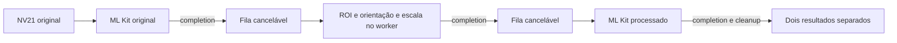

# TASK-09 — candidato ROI em RAM, Etapa 2

Implementação experimental `roi-1`, não correção comprovada. Código funcional
fixado em **150bc6419feec9c78b6b0c634cca13a2c66007a0**, branch
`feat/task-09-roi-ram`, derivada de `27212a4` do PR #80 ainda aberto/draft.
Staging consultado em `a106a39`; nenhum merge intermediário exigido/executado.
Checkout anterior e referências históricas preservados. Não há APK novo,
instalação, coleta ou habilitação clínica nesta entrega.

Referências: constitution.md, spec-fotografia §§3/6, Etapas 1–4 do
[plano](task-09-plano-correcao-segmentos.md) e
[revisão da Etapa 1](task-09-diagnostico-visor-real.md#revisão-da-etapa-1--veredito-parcial).
A/B histórico continua uma tentativa por estímulo: A com três campos corretos;
B com rótulos presentes, sem ASCII nos tokens filtrados e campos ausentes.
Não determina ausência no SDK, incapacidade universal ou causa no LCD real.

## Uma variante, parâmetros fixos

| Item | Implementação |
|---|---|
| Guia nominal | Margem `0.08` em cada eixo do PreviewView; coordenadas em pixels da view, não do sensor. |
| ROI efetivo | Projeção CameraX ao quadro upright completo; bordas arredondadas para fora em múltiplos de 2, dentro do quadro, para preservar alinhamento YUV420. |
| Escala | `min(2, 1600/max(larguraROI,alturaROI), sqrt(1920000/áreaROI))`; saída arredondada para baixo em dimensões pares. Sem controle de parâmetros na UI. |
| Resampling | Bilinear independente de Y e VU; uma única saída NV21, com orientação/recorte/escala fundidos. Sem buffer upright intermediário. |
| Motor | ML Kit latino embarcado `16.0.1`, mesmas dependências operacionais. |
| Variante 2 | Não implementada. Não há evidência para justificar luminância; B já tem alto contraste visual. |

Hipótese: concentrar a região útil e entregar dimensões controladas ao OCR pode
alterar legibilidade. Não há ganho, tempo ou acerto medido. Resampling é uniforme,
não reconhece/reconstrói segmentos nem preenche lacunas de um dígito conhecido.

O usuário deve enquadrar **LCD, números e rótulos externos SIS/DIA/PULSO da
carcaça à direita dentro da guia efetiva**. Não há detector automático de LCD ou
garantia de preservação se elementos ficarem fora da guia. A orientação textual
acompanha o contorno; não se enquadra somente o LCD. Não há nova medição clínica
ou mídia do autor incorporada ao código/fixtures.

## Correspondência da guia com o quadro

1. Em comparação, Preview e ImageAnalysis são vinculados no mesmo
   `UseCaseGroup`, com o `ViewPort` do PreviewView e target rotation congelada.
   Dimensões e rotação são as efetivamente recebidas no ImageProxy.
2. `PreviewView.outputTransform` fornece `Tp`, viewport normalizado → preview.
   `ImageProxyTransformFactory` com `usingCropRect=false` e
   `usingRotationDegrees=true` fornece `Tf`, viewport → quadro upright completo.
   Na implementação CameraX 1.5.1 o crop do ViewPort participa da transformação
   normalizada mesmo com false; false evita renumerar a origem como um buffer
   já recortado. `CoordinateTransform(Tp,Tf)` calcula `M = Tf × inverse(Tp)`.
3. O ROI nominal na view é projetado por M. Após o alinhamento YUV, a guia
   **desenhada** é `inverse(M)(ROI efetivo)`. Preview e overlay são filhos do
   mesmo FrameLayout, no mesmo espaço local; ExpoView é LinearLayout e por isso
   não recebe os dois como filhos lado a lado.
4. Ready exige preview STREAMING e guia efetivamente desenhada, não só calculada.
   No frame solicitado a projeção é recalculada e comparada àquela desenhada:
   dimensões, rotação, ROI/saída iguais e diferença de matriz nos cantos da view
   de até `0.25` pixel de origem, tolerância fixa para representação numérica.
   Mudança de tamanho/rotação/ROI ou transformação indisponível encerra/recusa a
   tentativa. Não há retângulo arbitrário de sensor ou fallback sem guia.

`FrameTransform` rejeita dimensões inválidas, matrizes não finitas/singulares,
perspectiva/shear e ROI fora do quadro. Aceita afins alinhadas aos eixos ou quarter
turns. Testes sintéticos verificam o caminho view→ROI→view com escala/corte,
as quatro rotações, números à esquerda e rótulos à direita. Isso prova o cálculo
sob essas entradas e o uso das APIs na fonte; **não é medição no Samsung**.
Compatibilidade da combinação CameraX/preview/driver continua dependente de
build e runtime do candidato. A demo falha fechada se não obtiver a transformação.

## Coordenadas e comparação

O original recebe o NV21 completo e sua rotação CameraX. O processado é amostrado
do mesmo NV21, já upright, e entregue ao ML Kit com rotação zero. Para 90/270 as
dimensões orientadas de origem são trocadas. Não rotacionar caixas novamente.
Caixa processada em pixels `(x,y,w,h)`, ROI upright `(L,T,R,B)`, escalas efetivas
`sx=larguraSaída/(R-L)`, `sy=alturaSaída/(B-T)` e origem orientada `(W,H)` volta a:

`((L+x/sx)/W, (T+y/sy)/H, w/(sx*W), h/(sy*H))`.

Caixas são limitadas à saída antes da inversão; não se atribuem coordenadas de
preview ao parser. Testes cobrem identidade, bordas, ida/volta e preservação da
ordem VU. Ambos os resultados seguem `upright-frame` da origem e o mesmo
`capturedAtMs`. Parser, gramática, filtros de 500 linhas/500 caracteres e regra
de não inventar números permanecem preservados.

Na demo, seleção explícita “comparação original/processado” exige capacidade
nativa `captureRevision=roi-1` e `comparisonRevision=roi-1`. APK antigo não inicia
essa câmera nem usa recognize como fallback. Metro sozinho não instala o recurso.

`CaptureRun` centraliza as transições; a segunda chamada só começa após completion
real da primeira e completion do worker. Cancelamento é verificado nas duas filas
e por linha durante transformação. Sem chamadas concorrentes/retry silencioso.
Falha técnica de uma passagem recusa o par; não publica só o resultado aparentemente
melhor. UI mostra dois conjuntos somente leitura, sem editor, confirmação, seleção
de melhor resultado ou transferência à revisão clínica. Cancelar, background,
recapturar, mudar modo, desmontar ou reiniciar efeitos descarta o par. Troca de
modo também aguarda a barreira de cleanup. Produto não monta esse modo.

## Ownership e limites

- Dimensões pares positivas e `MAX_FRAME_PIXELS=1920000`. FrameBytes agora valida
  spans/strides/posições/limites dos três planos antes de alocar a cópia; índices
  usam long para evitar overflow. Padding, offsets e buffers read-only preservados.
- No máximo dois arrays próprios de pixels: original e saída. Cada NV21 tem até
  `2880000` bytes; limite conjunto explícito `5760000`, verificado antes de
  processar/alocar. São limites derivados/configurados, não memória medida.
- Não há terceiro array de rotação, arquivo de mídia, URI, Bitmap.compress,
  upload, logger clínico, cache/fila persistente ou dependência nova do app.
- Transformação fica em executor dedicado para não ocupar a fila principal.
  A lease global e os buffers de uma chamada SDK em voo sobrevivem ao cancelamento
  até seu Task completion. Worker em voo também retém a origem até terminar.
  Completion tardio é descartado; nunca reabre câmera ou inicia a segunda passagem.
- Se cleanup não for confirmado, novos inícios ficam bloqueados. Falha ao registrar
  listener após SDK aceitar o buffer não presume liberação. Remover referências
  não garante apagamento físico/instantâneo da RAM.

O teto acima **não** inclui CameraX, GPU, strings/tokens, filas do runtime ou
memória interna/cópias do SDK. Dois resultados têm limites de tokens já existentes;
tempo e memória total ainda precisam ser medidos com ferramenta adequada, sem
heap dumps clínicos. Dados sensíveis continuam exclusivamente transitórios.

## Verificações executadas e alcance

- Lint, TypeScript raiz/demo, **828 testes em 71 suítes** aprovados. Avisos de act
  de edição/tema continuam sem falha. Testes novos cobrem par separado, vazio,
  contrato/ROI/budget inválidos, sanitização, ausência de fallback, capability de
  APK antigo, cleanup, resultado tardio, background, recaptura e mudança de modo.
  UI testada sem controles de confirmação/edição na comparação.
- Checks Java puros: FrameBytes (13 casos de buffers/11 dimensões), FrameTransform
  (Y/VU, bilinear, rotações, bordas, guia e caixas de ida/volta, cancelamento,
  overflow/alocação) e CaptureRun (transições/completions/ownership). Pixels e
  matrizes inventados; callbacks SDK simulados, sem ML Kit executado.
- CaptureGuide compilou isoladamente com Kotlin 2.2.0 contra APIs reais Android
  (android-all API 35) e CameraX 1.5.1, sem doubles de câmera. AferiPhotoView também
  passou por checagem Kotlin contra classes reais CameraX/ML Kit, **com interfaces
  Expo substituídas por doubles mínimos**. Jars/ferramentas somente em /tmp, sem
  alterar dependências do app. Não é build Expo/Android completo, dex ou APK.
- CI amplia o job Java para os mesmos testes puros. Resultado remoto do head deve
  ser conferido no PR, sem transferir o CI verde de 27212a4 para esta entrega.

Não houve build APK, execução CameraX/ML Kit/Samsung, comparação física, prova de
leitura segmentada, tempo/alocação medidos ou inspeção integral de SDK/SO/rede.
As lacunas físicas da Etapa 1 continuam abertas. TASK-04/06/07/09/18 parciais,
habilitação clínica bloqueada. Um eventual sucesso no cartão não homologa LCD,
segundo aparelho, privacidade ou integração clínica.

## Verificação do futuro artefato — preparada, ainda não executada

**Não instalar nem coletar agora.** A próxima entrega de Etapa 3 deve materializar
o APK deste código em worktree nova e fixada no commit funcional acima, preservando
as cópias históricas. Não usar Build-AferiInspectorEvaluation.ps1 (fonteca786ed)
ou o atualizador fixado EDF→APK259 como se fossem genéricos para ROI.

| Ordem | Verificação requerida antes de solicitar instalação |
|---|---|
| 1 | Reconfirmar staging/PRs, HEAD/status limpo e ambiente Node/JDK/SDK. Destino novo; não sobrescrever pasta, copiar android/node_modules antigos ou limpar dados. |
| 2 | npm ci pelo lock raiz, mods reais de backup/inspector, prebuild só da demo com `--platform android --no-install`. Conferir uma propriedade `EX_DEV_CLIENT_NETWORK_INSPECTOR=false`. |
| 3 | `:app:assembleDebug --no-daemon --console=plain -PreactNativeArchitectures=arm64-v8a -PEX_DEV_CLIENT_NETWORK_INSPECTOR=false`, sem task install/abertura. Registrar versões e SHA-256 calculado do novo APK, fonte e status final. Nunca prever o hash. |
| 4 | Com o NOVO hash esperado explícito, `Get-AferiManifestMetadata` e `Get-AferiBackupMetadata`: pacote de avaliação, permissões selecionadas, allowBackup=false, referências/vinculação e exclusões legada/cloud/D2D. Não expor árvores brutas. |
| 5 | Inspeção estática dirigida do módulo/constantes ROI e efeito compilado do inspector; flags de build sozinhas não são prova de bytecode. Não confundir prebuild, checagem parcial Kotlin ou testes Java com APK novo validado. |
| 6 | `Compare-AferiApkSignatures.ps1` com `-OldApkPath/-OldExpectedSha256` e `-NewApkPath/-NewExpectedSha256` explícitos, para os artefatos locais identificados. Não usar defaults69/EDF, gerar assinatura ou publicar certificados. |
| 7 | Só ao preparar atualização posterior: reconfirmar instalado/modelo/pacote/hash, assinatura e estado da demo. Preparar guardas específicas para novo candidato; não presumir que APK259 continua instalado, não usar uninstall/clear/downgrade/bypass. |

Os comandos da tabela descrevem verificações, não uma sequência Windows já
executada ou solicitação de ação no dispositivo. Caminhos/identidades do Windows
não foram consultados. Quando houver build real, o roteiro será fixado para o
ambiente confirmado; não chamar expo run:android como atalho que instala/abre.

Retorno futuro de Etapa 3: somente fonte/status limpo, versões, etapa/resultado,
hash calculado, JSONs selecionados de manifesto/backup/assinaturas e estado da
inspeção compilada. Qualquer erro, fonte suja, hash mutável, pacote/permissão/regra
inesperada, assinatura divergente ou inspeção indisponível interrompe antes de
instalar; preservar pasta/artefato e devolver código de etapa/mensagem curta
sanitizada. Sem logs completos, certificados, payloads, screenshots clínicos ou
mídia. APK259/fontea649/bundle2191 continuam referências históricas, não resultados
do novo candidato. Próxima ação do autor nesta entrega: revisão do PR, sem telefone.
